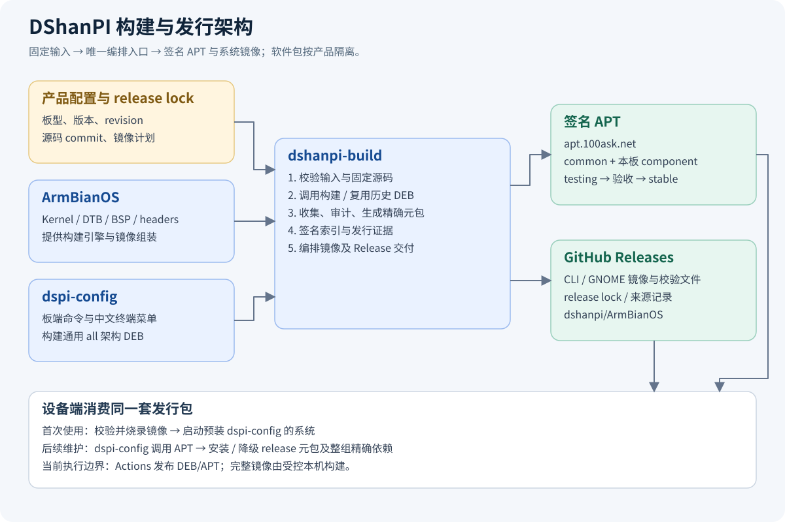
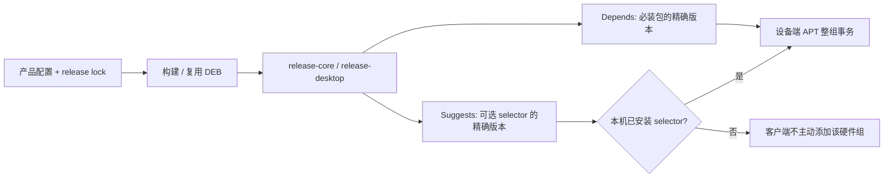
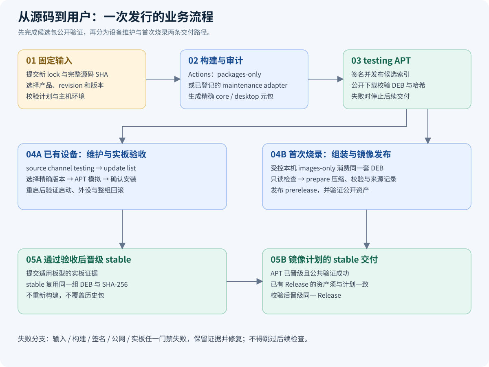
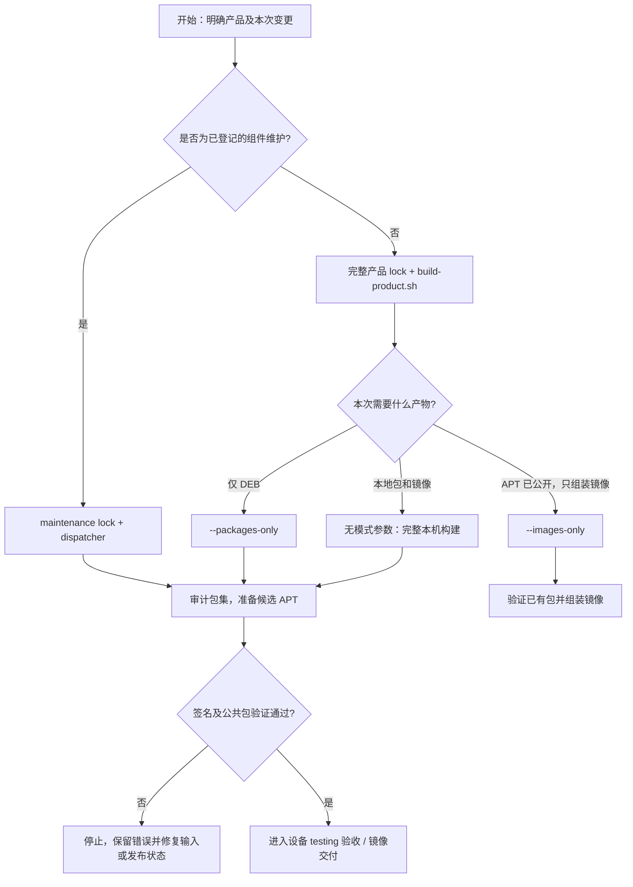
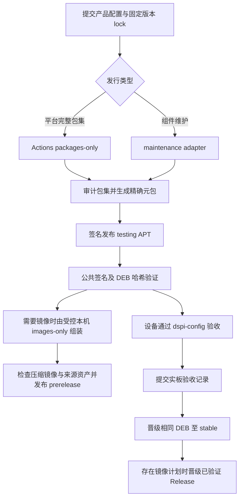

# dshanpi-build

DShanPI 的产品构建与发行编排入口：固定源码版本，构建和审计 DEB，生成精确依赖元包，发布签名 APT，并编排 CLI / GNOME 桌面镜像的组装、验收与 GitHub Release 交付。

本仓库适合系统维护者、驱动开发者和发行管理员。板端用户配置硬件、切换软件源或升级系统，请使用 **`dspi-config`**（也常被称为 dshanpi-config）。

本文介绍当前工具的使用方式。具体发行的可用状态，以对应版本的公开下载和验收记录为准。

## 按任务选择入口

| 你想做什么 | 从哪里开始 | 完成后得到什么 |
| --- | --- | --- |
| 在板子上配置外设、换源、升级系统 | [dspi-config 使用说明](https://github.com/dshanpi/dspi-config/blob/main/README.md) | 板端配置或整组版本安装结果 |
| 了解某产品的构建输入 | `build-product.sh … --print-plan` | 产品、revision、源码 commit 与镜像变体计划 |
| 构建一套新系统的软件包 | [构建模式与输出](#构建模式与输出) | 本地 DEB 包集及校验文件 |
| 发布候选 APT 更新 | [通过 Actions 发布 APT](#通过-actions-发布-apt) | testing 签名索引与公开包集验证结果 |
| 用已发布包制作可烧录镜像 | [本机构建和交付镜像](#本机构建和交付镜像) | CLI / GNOME 镜像、校验文件与来源记录 |
| 只更新某个已有可选驱动 | [维护发行与可选驱动](#维护发行与可选驱动) | 复用未变化包的新维护发行 |
| 将验收完成的候选交给正式用户 | Actions 的 `stable` 操作 | 同一组已验证 DEB 的正式渠道索引 |

首次接触时，建议依次阅读“仓库分工 → 版本与软件包 → 环境准备”，再按任务进入对应章节。下文命令默认在 **dshanpi-build 仓库根目录**运行。

## 目录

- [整体架构与实现框架](#整体架构与实现框架)
- [功能与仓库分工](#功能与仓库分工)
- [支持的产品](#支持的产品)
- [理解版本与软件包](#理解版本与软件包)
- [环境准备与快速开始](#环境准备与快速开始)
- [产品配置与 release lock](#产品配置与-release-lock)
- [构建模式与输出](#构建模式与输出)
- [业务流程与操作路线](#业务流程与操作路线)
- [通过 Actions 发布 APT](#通过-actions-发布-apt)
- [本机构建和交付镜像](#本机构建和交付镜像)
- [维护发行与可选驱动](#维护发行与可选驱动)
- [APT 仓库管理](#apt-仓库管理)
- [配置变量](#配置变量)
- [故障排查](#故障排查)
- [目录结构与进一步阅读](#目录结构与进一步阅读)

## 整体架构与实现框架



*图 1：从固定源码到设备使用的整体架构。左侧是输入，中间是发行编排，右侧是公开交付。*

本项目采用 **Bash 编排 + Python 校验/处理 + JSON 产品模型 + GitHub Actions 调度**，调用 ArmBianOS 的构建系统及 Debian/APT 工具链。阅读代码时，可按“输入模型 → 构建 → 包集 → 发布 → 验收”五层理解：

| 层次 | 主要文件或目录 | 输入 → 输出 |
| --- | --- | --- |
| 产品与版本模型 | `products/<product>/product.json`、`releases/*.lock.json` | 板型声明与源码 SHA → 可复现的发行计划 |
| 完整构建入口 | `scripts/build-product.sh` | 产品与 lock → 固定 checkout、DEB 包集、可选镜像 |
| 组件维护入口 | `scripts/build-maintenance-release.py`、`packages/` | 维护 lock 与已验签基础仓库 → 新组件包及新元包 |
| 包集与版本绑定 | `collect-packages.sh`、`build-release-meta.sh` | 声明的 DEB → 审计后的包集与精确 `Depends` |
| APT 发行 | `build-apt-repository.sh`、`publish-pages.sh` / `publish-apt.sh` | 不可变 DEB 与签名环境 → testing/stable 索引 |
| 镜像与来源记录 | `verify-image.sh`、`image-release.py` | 同一套 DEB 与 CLI/desktop 镜像 → 校验、压缩资产和 provenance |
| 交付验证 | `verify-product-public.py`、`publish-image-release.sh`、`validate-hardware-evidence.py` | 公开端点、固定计划与验收证据 → 对应阶段的验证结果 |

表内未写目录的脚本均位于 `scripts/`。**release 元包是连接构建端与设备端的版本契约**：例如 core 元包依赖 `linux-image-… (= 精确版本)`、`linux-dtb-… (= 精确版本)`、BSP 和 `dspi-config`。设备选择系统发行版本后，客户端把这一组确切版本交给 APT。



*图 2：系统发行号通过元包绑定包集；可选硬件仅按客户端已有 selector 同步。*

## 功能与仓库分工

| 能力 | 具体作用 |
| --- | --- |
| 固定构建输入 | 用产品配置和 release lock 指定板型、完整源码 commit、发行版本及平台 revision |
| 统一构建入口 | 调用 ArmBianOS 与 dspi-config 原有构建系统，复用公共脚本 |
| 严格收集软件包 | 按声明的包名、版本和架构收集，拒绝缺包、重复身份及其他产品混入 |
| 生成系统版本 | 制作 core / desktop 元包，以精确 `Depends` 绑定配套内核、DTB、BSP、工具等 |
| 可选硬件发行 | 固定驱动来源、DKMS、运行库和固件，使用 selector 表达配套与互斥关系 |
| 签名 APT | 构建 testing 索引、校验签名和包哈希、晋级 stable、撤回候选 |
| 镜像组装 | 将同一套发行 DEB 安装到 CLI 和 GNOME 镜像，检查版本、DTB、profile 和签名源 |
| 发布证据 | 保存包清单、SHA-256、镜像来源和硬件验收记录，关联公开下载验证 |

三个源码仓库通常并列放置：

```text
workspace/
├── ArmBianOS/       # 板卡、Kernel / U-Boot、DTS / DTBO、BSP 与镜像构建引擎
├── dspi-config/     # 板端菜单、Overlay、软件源与系统升级/回滚
└── dshanpi-build/   # 固定输入、包配方、构建编排、签名 APT 与发行证据
```

板级源码在 ArmBianOS 修改；可选驱动的上游锁、补丁和打包配方在本仓库维护；用户交互在 dspi-config 修改。不要在本仓库复制内核源码或另建一套客户端更新器。

## 支持的产品

| 产品 | 内部标识 / APT component | Armbian branch | 内核包命名空间 |
| --- | --- | --- | --- |
| DShanPI A1 | `dshanpi-a1` | `vendor` | `rk35xx` |
| DShanPI A1 CM5 | `dshanpi-a1-cm5` | `vendor` | `rk3576-dshanpi-a1-cm5` |
| DShanPI R1 | `dshanpi-r1` | `vendor` | `rk35xx` |
| Avaota A1 | `avaota-a1` | `legacy` | `sun55iw3-syterkit` |

命令、配置与包名统一使用内部标识，Avaota A1 使用 `avaota-a1`。A1 / R1 可以共享经过声明和固定版本的内核，BSP、软件源入口及发行元包仍按产品隔离；CM5 保持独立内核命名空间。支持某产品配置，不等于该产品所有外设已经完成实板验证。

## 理解版本与软件包

| 身份 | 示例 | 含义 |
| --- | --- | --- |
| 操作系统系列 | Ubuntu 24 / noble | 首次烧录的基础系统系列 |
| 系统发行版本 | `2026.10.14-1` | 一套配套 DEB 的版本，由 release 元包标记 |
| Armbian revision | `25.11.0-trunk.20261014.1` | 平台包构建版本，由 release lock 固定 |
| 单个 DEB 版本 | `dspi-config=1.0.3-1` | 组件自身版本，独立于系统发行版本 |

`<product>-release-core` 用于 CLI，`<product>-release-desktop` 用于桌面；两者分别具有完整精确依赖，桌面元包可独立安装。`<product>-repository` 提供该板签名源配置，`dshanpi-archive-keyring` 提供归档公钥。

客户在同一 OS 大版本内通常只需首次烧录，之后通过 APT / dspi-config 获取软件、驱动、内核和 BSP 更新。新系统发行号不要求重做镜像；发行版大版本、分区或引导布局迁移另行规划，详见 [固定镜像与持续 APT 更新规范](docs/fixed-image-apt-updates.md)。

**不可覆盖历史身份：** 同一个包名、版本和架构必须保持相同字节。改安装内容、依赖、维护脚本或包内 README 时递增 DEB 版本；修改平台包时使用新的 revision，历史 lock、DEB 和 tag 保留不变。

## 环境准备与快速开始

推荐使用原生 **Ubuntu 24.04 x86_64** 和具备 sudo 权限的普通用户。构建脚本使用 `PREFER_DOCKER=no`。镜像环境需准备 ARM64 rootfs 与交叉构建工具，Armbian 还会安装额外依赖。

- 软件包模式预检至少需要 5 GiB 可用磁盘；镜像模式至少需要 100 GiB。这是起始门槛，多产品、多镜像与缓存会占用更多空间。
- 主机内存建议 16 GiB 或更多。
- 需要访问 GitHub、Ubuntu 软件源和组件上游下载地址；源码 commit、下载哈希仍须逐项校验。

```bash
sudo apt-get update
sudo apt-get install -y git curl ca-certificates python3 python3-yaml jq \
  dpkg-dev gnupg patchelf xz-utils build-essential ripgrep rsync \
  qemu-user-static binfmt-support device-tree-compiler pigz sudo
```

从仓库根执行以下只读预检：

```bash
python3 scripts/preflight-host.py --mode packages --network
sudo -v
python3 scripts/preflight-host.py --mode images
```

新服务器需要固定三仓版本时，按 [新服务器手册](docs/new-server.md) 获取 dshanpi-build 的指定完整 commit，再执行：

```bash
python3 scripts/checkout-workspace.py /absolute/path/to/new-workspace
```

下载器读取 `handoff/sources.json`，生成三仓 checkout 与 `workspace-lock.json`，拒绝覆盖已有仓库。交接清单用于复现交接快照；某次正式发行仍以其 **release lock** 为准。

先用仓库中已有的完整镜像 lock 查看计划，无需签名私钥或实际构建：

```bash
scripts/build-product.sh avaota-a1 \
  products/avaota-a1/releases/2026.10.14-1.lock.json --print-plan
```

该命令只验证并打印产品、版本、revision、两种镜像变体及源码 commit；不会下载源码、构建或发布。历史 lock 可用于了解/复现历史输入，不应作为修改后覆盖同版本的模板。

### 为其他产品预览计划

同一入口适用于四种产品；先选择产品，再查看本地有哪些已登记 lock：

```bash
PRODUCT=dshanpi-a1-cm5  # 可替换为 dshanpi-a1、dshanpi-r1、avaota-a1
ls "products/$PRODUCT/releases/"*.lock.json
# 复制列表中的实际路径，赋给 LOCK 后再预览
# LOCK=products/<product>/releases/<version>.lock.json
# scripts/build-product.sh "$PRODUCT" "$LOCK" --print-plan
```

维护 lock 应使用维护 dispatcher 的 `--print-command`。预览通过仅说明输入能够被当前入口解析；源码下载、依赖完整性、构建和实板验收分别在后续步骤确认。

## 产品配置与 release lock

`products/<product>/product.json` 定义产品长期配置：

| 字段 | 作用 |
| --- | --- |
| `armbian` | board、branch、发行版与桌面配置 |
| `sources` | ArmBianOS / dspi-config 的源码仓库地址 |
| `component` / `common_packages` | 板级 component 与公共包归属 |
| `required_packages` | 必须收集的包及架构；构建完成后写入精确版本依赖 |
| `package_search_paths` | 允许搜索的 Armbian 产物目录 |
| `release_meta` | core / desktop 差异和元包配置 |
| `optional_package_sets` | 可选硬件包组 |
| `release_package_sets` / `release_optional_selectors` | 完整发行构建的可选包组与元包 `Suggests` |
| `package_adapters` | 产品所需的受控包适配器 |

最终包集由配置声明决定，不会直接发布整个 `output/debs`。Armbian 缓存中同版本存在多个候选会报错，不按文件时间猜测“最新包”。

一次发行使用 `products/<product>/releases/<version>.lock.json`，共同必需项为：

```text
schema_version              1
product                     与产品目录一致
version                     YYYY.MM.DD-N，N 为正整数
revision                    本次平台包 revision
sources.armbianos.commit    完整 40 位小写 Git SHA
sources.dspi_config.commit  完整 40 位小写 Git SHA
```

完整镜像发行还需要 `image_release`，固定仓库、tag、目标 commit、标题、testing/stable 状态、CLI/desktop 文件名与完整资产清单。维护发行使用 `maintenance_adapter`，并固定基础发行及其清单 SHA-256 和组件输入锁。两种入口不可混用。

```bash
scripts/validate-config.sh "$PRODUCT" "$LOCK"
python3 scripts/image-release.py validate "$PRODUCT" "$LOCK"  # 仅完整镜像计划
```

以上及后文 `$PRODUCT`、`$VERSION`、`$LOCK` 由操作者设置为实际产品、新发行版本与对应 lock 路径。不要把未提交的本地修改当成固定源码，正式构建会检查 checkout commit 和已跟踪文件是否干净。

## 构建模式与输出

```bash
export PRODUCT=avaota-a1
export VERSION=2026.10.14-1
export LOCK="products/$PRODUCT/releases/$VERSION.lock.json"
export APT_PUBLIC_KEY_FILE="$PWD/keys/dshanpi-archive.asc"
```

上面是历史输入示例。正式修改后发行需要新版本、新 commit 和配套 lock。

| 模式 | 命令末尾参数 | 行为 |
| --- | --- | --- |
| 预览 | `--print-plan` | 验证并显示计划，无构建 |
| 只构建包 | `--packages-only` | 构建平台/客户端/配套包和元包，不进入镜像组装 |
| 只组装镜像 | `--images-only` | 从签名公共仓库获取该发行精确 DEB，不重建 DEB，再组装 CLI/desktop |
| 完整本机构建 | 无额外参数 | 构建包并组装两种镜像；本命令本身不发布 |

```bash
scripts/build-product.sh "$PRODUCT" "$LOCK" --packages-only
# 或在对应 APT 包已公开后执行：
scripts/build-product.sh "$PRODUCT" "$LOCK" --images-only
# 或在受控本机构建服务器执行完整构建：
scripts/build-product.sh "$PRODUCT" "$LOCK"
```

这三种执行命令按需要选用。`--images-only` 会验证签名根清单、该产品发行清单、DEB 身份和 SHA-256，拒绝额外包与不一致缓存；已完成且哈希匹配的文件可复用。它还拒绝覆盖调用者已有的 `ArmBianOS/userpatches/lib.config`。

A1 的完整包构建还需要 `DSHANPI_PUBLISHED_REPOSITORY` 指向已验签的历史仓库，用于发行绑定可选包与历史字节复用；Actions 会传入该目录。源码缺失时脚本按 lock 自动 checkout，不能用相近分支替代。

默认输出：

```text
work/<product>/<version>/sources/       # 固定版本的源码工作区
output/<product>/<version>/
├── client/                            # 软件源与 keyring 包
├── dspi/                              # 配置工具 DEB（构建包模式）
├── packages/                          # 最终包集、core/desktop 元包、SHA256SUMS
├── images/                            # 通过只读检查的 CLI / desktop 镜像
└── image-release/                     # prepare 步骤生成的压缩镜像和来源资产
```

中间目录会因产品和模式不同而变化。最终镜像安装 release 元包及全部精确依赖，不要求构建中的候选先出现在公开源；对外交付前必须完成公共 APT 验证。

## 业务流程与操作路线



*图 3：已有设备通过 APT 持续维护，首次安装通过镜像交付；两条路径关联同一套 DEB。*

### 第一步：先确定本次任务



*图 4：构建模式选择。维护 lock 与完整镜像 lock 分属不同入口。*

### 第二步：按阶段执行并确认结果

| 阶段 | 操作地点与动作 | 通过标志 | 失败后如何处理 |
| --- | --- | --- | --- |
| 1. 准备 | 维护者工作区：确定产品，提交新 lock，固定源码 commit | `validate-config.sh` 和 `--print-plan` 通过 | 修正新计划，不改写历史 lock |
| 2. 构建 | Actions testing 或受控本机：按任务选构建入口 | 包集齐全，身份与版本一致，元包精确依赖通过 | 查构建日志、源码 SHA 与缓存；修复内容需新版本 |
| 3. 候选公开 | Actions：签名、发布 testing、执行公共验证 | 公共索引和下载 DEB 的签名、SHA-256 一致 | 检查部署及公共缓存状态；不关闭验签 |
| 4. 设备验收 | 本板终端：切 testing，列出并安装精确版本 | 安装、重启、受影响外设和回滚有实板证据 | 保留日志；必要时显式恢复仍可用的旧版本 |
| 5. 镜像交付 | 受控本机：`--images-only`、检查、`prepare`、按计划发布 | CLI/desktop、headers 和来源资产均可公开验证 | 修复校验/上传问题；已有 tag 不强制覆盖 |
| 6. 正式晋级 | Actions stable：核对硬件证据并晋级同一组包 | stable APT 验证通过；存在镜像计划时对应 Release 验证通过 | 留在候选阶段，补齐证据后再执行 |

包维护发行通常完成阶段 1～4、6；完整镜像发行还必须完成阶段 5。当前 Actions 的 testing 操作负责 DEB/APT，完整镜像组装仍在受控本机进行。图示描述交付关系，不表示所有步骤已经由一次 Actions 调用自动完成。

### 第三步：让设备用户安装本次候选

维护者确认该产品 testing 包集已公开后，在**目标板卡终端**执行：

```bash
sudo dspi-config source channel testing
sudo dspi-config update list
read -r -p '输入列表中的目标系统发行版本：' TARGET_VERSION
if [ -n "$TARGET_VERSION" ]; then
  sudo dspi-config update install "$TARGET_VERSION"
fi
```

查看 APT 模拟输出并确认安装；涉及内核/BSP/驱动时安排重启，再运行 `sudo dspi-config status` 并验证受影响硬件。这里输入的是系统发行版本，不是单独的工具版本。回滚及硬件细节见 [dspi-config 使用文档](https://github.com/dshanpi/dspi-config/blob/main/README.md) 和 [实板验收手册](docs/hardware-acceptance.md)。

## 通过 Actions 发布 APT

工作流为 [Build and publish DShanPI product](.github/workflows/release.yml)。在 Actions 中选择含本次 lock 的源码分支/提交，填写：

| 输入 | 含义 |
| --- | --- |
| `product` | 产品内部标识 |
| `version` | 与已提交 lock 文件名和内容一致的版本 |
| `channel=testing` | 构建包、生成元包、审计、签名并发布 testing |
| `channel=stable` | 核验实板证据，晋级 testing 中的同一组包 |
| `channel=withdraw` | 撤回指定 testing 发行索引，保留历史 pool |
| `channel=purge` | 执行已评审的专用清理计划，见下文 |
| `backend` | `github-pages` 或预先配置的 `ssh` 后端 |

**当前执行边界：GitHub 托管 Actions 负责 DEB / APT，完整镜像在受控本机构建。** 即使 lock 包含 `image_release`，testing 工作流也采用 `--packages-only`，不会构建或上传新镜像。stable 可在 APT 晋级及公共验证后处理已存在的计划镜像 Release。



签名环境配置 `APT_GPG_PRIVATE_KEY` 与 `APT_GPG_KEY_FINGERPRINT`；操作目标 ArmBianOS Releases 时配置受保护的 `ARMBIANOS_RELEASE_TOKEN`。SSH 后端另需主机、端口、用户、认证及已验证 host key，参数见工作流。私钥与令牌不写入源码、镜像或文档。

## 本机构建和交付镜像

推荐先完成 CI 的签名 APT 发行，再用同一 lock 执行 `--images-only`。这样镜像消费的就是已经公开的原始 DEB。

```bash
python3 scripts/check-release-executor.py "$LOCK" testing local
scripts/build-product.sh "$PRODUCT" "$LOCK" --images-only

# build-product.sh 已对两种镜像执行检查；独立复查可用：
sudo scripts/verify-image.sh "$PRODUCT" "$VERSION" /absolute/path/to/image.img

python3 scripts/image-release.py prepare "$PRODUCT" "$LOCK" \
  "output/$PRODUCT/$VERSION/images" \
  "output/$PRODUCT/$VERSION/packages" \
  "output/$PRODUCT/$VERSION/image-release"
```

镜像检查以只读方式挂载根分区，必要时挂载独立 FAT boot 分区，检查发行元包及依赖、板卡/DTB、profile 和签名源；兼容受支持的 armbianEnv / extlinux DTB 路线。它不能证明实板能够启动或所有外设可用。

`prepare` 校验镜像旁的 SHA-256 文件，生成 `.img.xz`、`SHA256SUMS`、`package-SHA256SUMS`、`release-lock.json`、`release-provenance.json` 及旁侧的 `release-notes.md`。来源记录关联三仓版本、镜像和 DEB 哈希，说明中包含对应 headers 下载地址、大小和精确 APT 安装命令。

发布前先验证公共 APT：

```bash
python3 scripts/verify-product-public.py "$PRODUCT" "$VERSION"
```

以下命令会写入 GitHub Release，限已授权的发行任务并使用具备目标仓库权限的 `gh` 认证：

```bash
scripts/publish-image-release-direct.sh "$PRODUCT" "$LOCK" \
  "output/$PRODUCT/$VERSION/image-release" \
  "output/$PRODUCT/$VERSION/release-notes.md"
```

直接发布器仅允许在 Actions 之外执行，按固定资产清单创建 prerelease；若同 tag Release 已存在会停止，不覆盖。它不替代上传后的资产哈希核对。需要恢复草稿、核对已存在资产或执行 stable 晋级时，使用带内容校验的 `scripts/publish-image-release.sh`，不要删除 tag 或强制覆盖资产。

每个镜像必须提供**完全匹配的 `linux-headers-*` DEB**；头文件不是 `linux-libc-dev`。同源码、配置、revision、kernel release、`Module.symvers` 与外部模块编译验证是 G12 要求，不能只看内核主版本。完整交付还需确认 Release 页面、tag commit、状态、全部下载资产与哈希。

### 发布后如何核对交付物

| 交付物 | 核对内容 | 使用者 |
| --- | --- | --- |
| 签名 APT 索引和发行清单 | 产品、渠道、包名/版本/架构、签名与 SHA-256 一致 | 设备用户、发行维护者 |
| CLI / desktop `.img.xz` | 两种变体齐全，文件名符合 lock，压缩可解码，下载哈希匹配 | 首次烧录用户 |
| `SHA256SUMS` | 对应最终上传的资产；在下载目录执行 `sha256sum -c SHA256SUMS` | 镜像下载者 |
| `package-SHA256SUMS` | 镜像所用 DEB 的哈希，与该发行 APT 包集对应 | 发行审计与复现人员 |
| `release-lock.json` / `release-provenance.json` | 固定三仓输入及镜像、软件包的来源关联 | 维护者 |
| 精确匹配的 headers DEB | 公开下载、大小、版本、ABI 与安装命令均有记录 | DKMS / 外部模块开发者 |

下载校验通过后再解压和烧录。烧录会写入目标介质，请按板卡的启动方式选择介质；通用 README 不提供一个可直接覆盖任意磁盘的烧录命令。已有系统若仅需软件维护，走 APT 更新路径即可。

## 维护发行与可选驱动

普通应用、配置工具、固件和驱动更新通常使用包维护发行，复用基础发行中未变化的原始 DEB，再生成新 core/desktop 元包；客户无需重新烧录。

当前统一 dispatcher 登记了 **A1 的 `axcl`、`axcl-16g`、`aic8800d80`** 三种维护 adapter，并非所有组件都有通用 adapter。新增组件需补配方与映射。

```bash
# 历史维护 lock 的只读命令预览
python3 scripts/build-maintenance-release.py dshanpi-a1 2026.10.09-4 \
  output/repository --print-command

# 对实际维护版本执行；repository 必须是已验证的基础仓库副本
python3 scripts/build-maintenance-release.py "$PRODUCT" "$VERSION" output/repository
```

维护 lock 交给 dispatcher；`build-product.sh` 会拒绝维护 lock。

| 组件 | 文档与注意事项 |
| --- | --- |
| AXCL 初版 / 8GB 路线 | [AXCL 说明](packages/axcl/README.md)，核对运行库、DKMS 与实际卡容量 |
| AXCL 16GB | [16GB 说明](packages/axcl-16g/README.md)，runtime / PAC 配对、平台精确依赖及验收边界 |
| AIC8800D80 | [无线与蓝牙说明](packages/aic8800d80/README.md)，DKMS、固件和 selector 的安装测试 |

A1 完整发行用 lock 的 version / revision 派生 AXCL 配套版本，将可选 selector 写入元包精确 `Suggests`。设备只同步已安装的 selector；没有对应硬件时不强装，也不会静默切换 8GB / 16GB。

## APT 仓库管理

| 项目 | 值 |
| --- | --- |
| 仓库根地址 | `https://apt.100ask.net` |
| stable suite | `noble` |
| testing suite | `noble-testing`，带 `NotAutomatic`，需显式选择 |
| 公共 component | `common` |
| 板级 component | 与产品标识一致 |
| 在线升级排除项 | U-Boot、`linux-libc-dev` |

以下是发行维护命令；构建与签名操作先作用于本地仓库副本，`publish-*` 才会写入远端。必须先取得现有状态，不能用空目录意外替换已有仓库。

```bash
scripts/fetch-pages.sh output/repository keys/dshanpi-archive.asc

scripts/build-apt-repository.sh testing "$PRODUCT" "$VERSION" \
  "output/$PRODUCT/$VERSION/packages" output/repository "$APT_GPG_KEY_FINGERPRINT"

# 完成候选实板验收后，由正式工作流晋级；本地底层操作为：
scripts/promote-apt-release.sh "$PRODUCT" "$VERSION" \
  output/repository "$APT_GPG_KEY_FINGERPRINT"

# 撤回失败候选时执行；不撤销已安装到用户设备的软件：
scripts/withdraw-testing-release.sh "$PRODUCT" "$VERSION" \
  output/repository "$APT_GPG_KEY_FINGERPRINT"

scripts/publish-pages.sh output/repository keys/dshanpi-archive.asc
# SSH 接收端作为另一种后端：scripts/publish-apt.sh output/repository
```

这些命令按目标分步选择，不能将“加入候选 → 晋级 → 撤回”作为连续发布脚本。底层 promote 命令不能代替工作流的实板证据门禁；验收格式见 [硬件验收手册](docs/hardware-acceptance.md)。

Pages 的签名状态保存在 `feature/apt-pages-state`，大文件按 64 MiB 分块，部署前重组并校验；内容预算为 950 MB，超限停止。公共域名 DNS / Pages 配置、受保护环境与工作流权限需由管理员预先完成。状态快照不依赖短期 Actions artifacts。

常规撤回保留历史包和回滚来源。`purge` 只用于已有评审计划的废弃 testing 批次，拒绝曾晋级 stable 的目标，且只清除无任何保留引用的 pool 文件；不得手工批量删除。细则见 [持续 APT 更新规范](docs/fixed-image-apt-updates.md)。

## 配置变量

| 变量 | 默认值 / 作用 |
| --- | --- |
| `APT_PUBLIC_KEY_FILE` | 执行构建时必需，指定用于客户端与仓库验证的公钥文件 |
| `APT_GPG_KEY_FINGERPRINT` | 本地签名命令传入的归档密钥指纹 |
| `DSHANPI_WORK_ROOT` | 默认 `work/<product>/<version>`，源码工作目录 |
| `DSHANPI_OUTPUT_ROOT` | 默认 `output/<product>/<version>`，构建输出 |
| `DSHANPI_ARMBIANOS_DIR` | 复用已有 ArmBianOS checkout，必须匹配 lock 且干净 |
| `DSHANPI_DSPI_CONFIG_DIR` | 复用已有 dspi-config checkout，同样检查 commit |
| `DSHANPI_APT_BASE_URL` | 默认 `https://apt.100ask.net`，表示完整根地址，不追加 `/apt` |
| `DSHANPI_PUBLISHED_REPOSITORY` | 已验签历史仓库路径，用于复用不可变 DEB 与发行绑定可选包 |
| `DSHANPI_PAGES_GIT_REMOTE` | Pages 状态读写 remote，默认 `origin` |

目录覆盖建议使用绝对路径。开发调试开关不能作为正式构建绕过固定输入门禁的手段。`build-client-packages.sh` 的 `BASE_URL` 参数同样表示完整仓库根地址。

## 故障排查

| 现象 | 排查与处理 |
| --- | --- |
| `source does not match release lock` | 用 `git rev-parse HEAD` 对照 lock，切换精确 commit；不改 lock 冒充历史构建 |
| `source has tracked changes` | 提交代码后创建新发行输入，或使用匹配版本的干净 checkout |
| `package maintenance lock` | 使用 maintenance dispatcher，确认对应 adapter 已登记 |
| 包缺失或身份重复 | 核对产品包清单、revision、架构和搜索目录，隔离历史缓存；不随意选一份 |
| 同身份不同字节 | 保留历史 DEB；对真实内容变化递增版本，或校验后复用历史原始字节 |
| images-only 获取失败 | 确认本版 APT 已公开、签名和哈希正确；保留错误，网络恢复后重试，不禁用验签 |
| `userpatches/lib.config` 已存在 | 使用干净构建 checkout 或人工整合已有配置，不覆盖用户文件 |
| Pages 容量或并发状态冲突 | 重新获取当前状态；容量不足时规划扩容托管，保留历史与回滚路径 |
| 依赖解析失败 | 核对本板 component、平台精确版本、可选 selector 容量及候选是否仍在索引 |
| 无法晋级 stable | 核对候选清单 SHA、验收记录、引用日志哈希及全部适用实板项目 |
| Release tag 已存在 | 核对远端固定计划和资产；直接发布器拒绝覆盖，按恢复流程处理 |

软件测试、APT 依赖模拟、镜像只读验收、公开下载校验和实板验收是不同层次。启动、外设、DKMS / NPU、更新后重启及回滚必须有适用板型证据，未测项目如实记录。

## 目录结构与进一步阅读

```text
products/              产品配置、不可变发行 lock、包清单与验收证据
packages/              可选组件配方、来源锁与组件说明
scripts/               构建、收集、审计、签名、发布和校验入口
scripts/pages/         Pages 快照与按板卡/版本展示的仓库目录页
keys/                  可公开的归档公钥及指纹
tests/                 单元测试和本地 APT / 发行集成测试
tools/                 政策、变更记录及源码卫生门禁
handoff/               固定版本的三仓交接清单
docs/                  环境手册、验收规范、变更记录和历史证据
```

- [新服务器与固定版本复现](docs/new-server.md)
- [固定镜像与持续 APT 更新规范](docs/fixed-image-apt-updates.md)
- [实板验收与 stable 门禁](docs/hardware-acceptance.md)
- [归档公钥](keys/dshanpi-archive.asc) / [指纹](keys/dshanpi-archive.fingerprint)

本文插图的可编辑源文件位于 `docs/images/*.svg`；Mermaid 图直接维护在本文中。插图用于说明架构与操作关系，未使用实板截图冒充验收证据。

历史状态应结合具体发行 lock、包清单、验收记录及公开验证结果读取；本文中的示例日期不是“最新 stable”声明。

参与源码开发、增加产品或维护发行流程，请阅读 [开发维护指南](docs/development-guide.md) 与 [开发交付政策](DELIVERY_POLICY.md)。
