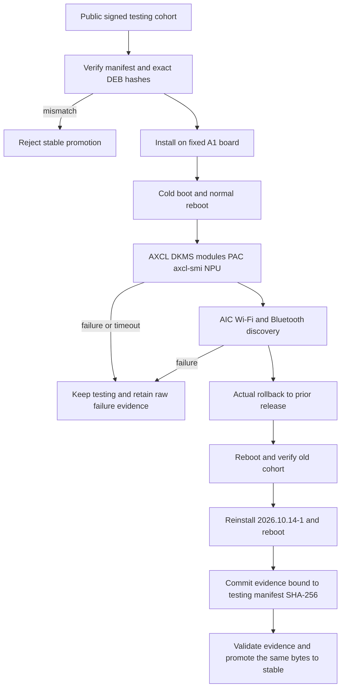

# A1 2026.10.14-1 stable hardware acceptance

## 需求与范围

The user requested that the already published `dshanpi-a1` `2026.10.14-1` testing cohort be
promoted to stable after adding active cooling to the AX8850 and repeating physical-board tests.
This change adds immutable acceptance evidence only. It does not rebuild, replace or modify any DEB,
release lock, image, dependency or package payload.

Applicable scope: original DShanPI A1, Ubuntu Noble, platform revision
`25.11.0-trunk.20261010.1`, AIC8800D80 and AX8850 16 GB. CM5, R1 and Avaota A1 package bytes are
unchanged. Their separately running image publication workflows are not evidence for this A1 verdict.

## 业务逻辑

Stable promotion consumes the exact public testing manifest and package hashes. The board must install
the release, boot and reboot, complete an actual rollback/reinstall cycle, and pass the A1 AXCL checks.
The AIC module must recover Wi-Fi and expose a working BlueZ controller/discovery path. A failure leaves
the cohort in testing and must not trigger an automatic hardware retry or package rebuild.

## 流程

## 安全与失败分支

- The package manifest SHA-256 is fixed to the public `2026.10.14-1` testing manifest.
- Stable promotion never rebuilds or overwrites a DEB and retains the testing and rollback records.
- Power actions use saved project 6/device 6 bindings and bounded waits; failed actions are not retried
  automatically. One final relay request was rejected by an active COM17 task before power changed;
  the non-conflicting customer reboot path was used instead and recorded.
- A first noninteractive rollback stopped at APT confirmation without changing state. One explicit
  operator confirmation completed it; the failed attempt is retained rather than reported as success.
- Credentials, SSIDs, discovered Bluetooth identities and terminal input are excluded from evidence.
- Package/source behavior, board bindings, partitions, images and other product releases remain unchanged.

## 测试报告

| 类型 | 命令/检查 | 结果 | 证据 |
| --- | --- | --- | --- |
| Public endpoint | Download release manifest and calculate SHA-256 | PASS: `933e9cc7...53eec` | Hardware acceptance log |
| Package verification | Compare five local/public AXCL DEBs with Packages hashes | PASS | Hardware acceptance log |
| Physical board | Install exact AIC/AXCL/release packages; `dpkg --audit` | PASS | Hardware acceptance log |
| Physical board | DKMS status and five AXCL module vermagic/load | PASS | Hardware acceptance log |
| Physical board | PAC check, PCIe `1f4b:0650`, `axcl-smi` | PASS | Hardware acceptance log |
| Physical board | `axcl_ut_npu` | PASS repeatedly: 20/20 | Hardware acceptance log |
| Physical board | Fan-cooled cold boot and normal reboot recovery | PASS: 41-46 C | Hardware acceptance log |
| Physical board | AIC Wi-Fi scan/connect/DNS/HTTPS/reboot recovery | PASS | Hardware acceptance log |
| Physical board | BlueZ controller and bounded discovery scan | PASS: five devices | Hardware acceptance log |
| Physical board | Actual rollback, cold reboot, reinstall and final reboot | PASS | Hardware acceptance log |
| Static gate | `validate-hardware-evidence.py` against signed repository snapshot | PASS | Local validator output |
| Repository gate | policy, change record, 60 Python tests, shell tests, diff check | PASS | Local command output |
| Public release | stable workflow and public catalog verification | NOT-RUN until merge | GitHub Actions and public catalog |

## 未完成项

Bluetooth pairing/transfer, Wi-Fi/Bluetooth concurrency, sustained multi-stream inference and a
long-duration thermal soak were not executed. They remain extended qualification items and are not
represented as passed by this release evidence. The noninteractive `DSPI_ASSUME_YES` path does not
currently pass `-y` to APT; the observed safe abort is recorded and requires a separate dspi-config
fix/version rather than changing this already tested cohort.

## 交付影响

After review, the existing `2026.10.14-1` package manifest is eligible for `channel=stable` promotion
through `release.yml` with the GitHub Pages backend. The operation reuses identical package hashes and
does not generate a new image. The fixed Ubuntu 24 A1 golden image remains the installation base.
