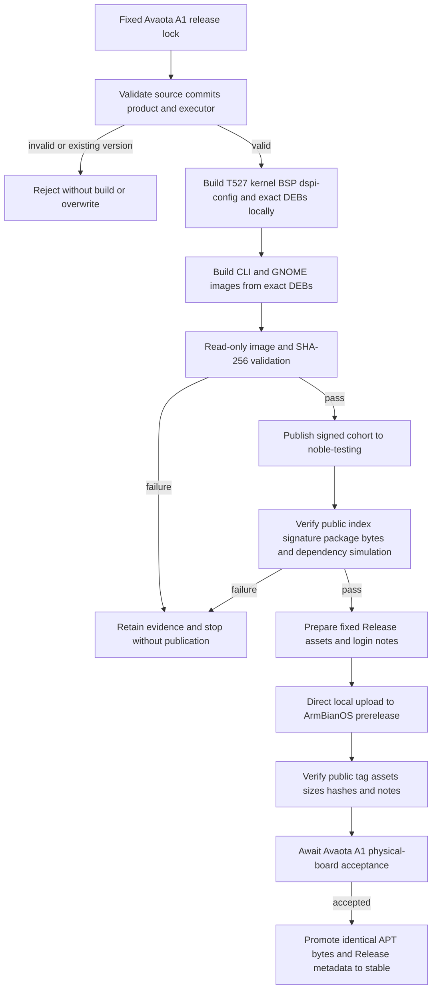

# Avaota A1 T527 fixed image and APT release

## 需求与范围

The user requested the same fixed-version delivery loop used for DShanPI boards for `avaota-a1`,
based on the Allwinner T527 platform. This release fixes the current ArmBianOS and dspi-config source
commits, builds the exact DEB cohort plus CLI and GNOME images on the controlled local builder, publishes
the signed package cohort to the testing APT channel and uploads the fixed image assets directly to
`dshanpi/ArmBianOS` Releases. It does not claim stable or physical-board acceptance.

## 业务逻辑

The release lock is the version fact source for product `avaota-a1`, release `2026.10.14-1` and Armbian
revision `25.11.0-trunk.20261014.1`. The product keeps its own APT component, BSP, T527 legacy kernel,
device tree and core/desktop release metadata. Both image variants consume the same exact signed package
cohort and expose the standard initial login contract. Complete image work runs locally; GitHub-hosted
CI remains available for signed APT publication and later promotion without rebuilding image bytes.

## 流程

## 安全与失败分支

- The source commits, product, revision, tag, image names and asset list are immutable inputs.
- GitHub-hosted Actions must reject complete-image testing before checkout or build; local image upload
  refuses existing tags and unexpected assets.
- Package identities with changed content require a new Debian version; historical packages and Releases
  are not deleted or overwritten.
- Missing T527 headers, kernel/headers mismatch, wrong DTB, unsigned source configuration, dependency
  failure or image verification failure stops publication.
- Upload or build failures are visible and are not treated as success; recovery reuses only verified bytes.
- Stable promotion requires separate Avaota A1 hardware evidence and never rebuilds the testing cohort.

## 测试报告

| 类型 | 命令/检查 | 结果 | 证据 |
| --- | --- | --- | --- |
| Policy | `python3 tools/check-delivery-policy.py --peer ../ArmBianOS --peer ../dspi-config` | PASS | Local output before modification |
| Plan | `scripts/build-product.sh avaota-a1 products/avaota-a1/releases/2026.10.14-1.lock.json --print-plan` | PASS | Fixed commits, legacy branch and CLI/Desktop variants printed |
| Unit | `python3 -m unittest discover -s tests -v` | PASS | 65 tests passed locally |
| Shell | `bash tests/test.sh` | PASS | `dshanpi-build tests passed` |
| Package build | Exact T527 DEB cohort | NOT-RUN | Local build output |
| Image validation | CLI and GNOME read-only verification | NOT-RUN | Local verification logs |
| Public APT | Signature, index, package hashes and simulated install | NOT-RUN | Public endpoint checks |
| Public Release | Tag, six fixed assets, hashes and login notes | NOT-RUN | GitHub Release API |
| Hardware | Boot, display, storage, Ethernet/Wi-Fi, USB and reboot recovery | NOT-RUN | No Avaota A1 board evidence supplied |

## 未完成项

All build and publication steps remain pending at record creation time. Avaota A1 physical-board testing
is not available in this session, so the image must remain a prerelease and the package cohort must remain
in testing until separate board evidence is committed.

## 交付影响

This adds a reproducible Avaota A1/T527 complete-image release without consuming GitHub-hosted image-build
minutes. Once the fixed image is installed, later ordinary DEB additions and updates use the signed APT
maintenance path and do not require customers to reflash the system.
