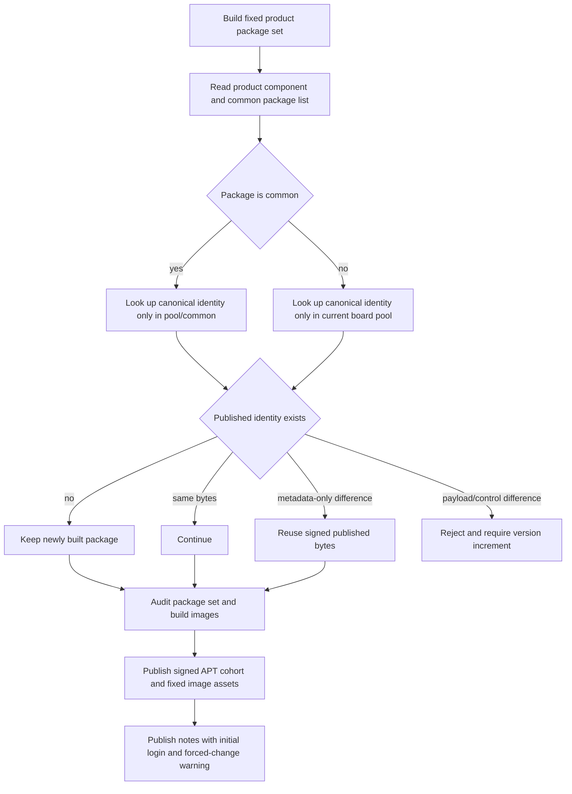

# Scope immutable package reuse to each board component

## 需求与范围

The user requested publication of the fixed Ubuntu Noble images for DShanPI A1 CM5 and DShanPI R1
after the A1 package cohort was promoted to stable. The R1 image build completed both image variants
but publication stopped because its board-specific `base-files` package was compared with the package
of the same Debian identity in the unrelated A1 component.

This change corrects the reuse gate's component scope and requires every generated ArmBianOS Release
description to publish the actual initial username, password and mandatory first-login password change.
It does not weaken immutable package checks, change package versions, replace published bytes, modify
release locks or alter image contents.

## 业务逻辑

The signed repository has a global `common` component and one isolated component per product. A local
package listed in `common_packages` may reuse only the canonical bytes from `pool/common`. Every other
package may reuse only bytes from the current product's pool. The same package identity with different
bytes in an unrelated board component is valid because clients enable only their saved board component.
Different bytes for the same identity inside the selected component remain a hard failure requiring a
new package version. Initial-login metadata is product-owned, included in release provenance and rendered
into the release notes; missing or unsafe values reject image-release preparation.

## 流程

## 安全与失败分支

- Repository signature verification remains mandatory before any published package is considered.
- Package identity collisions inside `common` or the current board component remain rejected.
- Changed functional payload or control data in the selected component still requires a version bump.
- Unrelated board components are excluded from canonical-byte selection and are never modified.
- Image and package publication remains serialized by `apt-repository-publication`; failed workflows do
  not retry automatically or overwrite an existing GitHub Release asset.
- Release preparation fails when initial-login documentation is missing or does not require password
  replacement on first interactive login.

## 测试报告

| 类型 | 命令/检查 | 结果 | 证据 |
| --- | --- | --- | --- |
| Unit | `python3 -m unittest -v tests.test_reuse_published` | PASS | Local test output |
| Regression | Unrelated A1 bytes do not block an R1 package identity | PASS | Unit test assertion |
| Immutable gate | Changed bytes inside the R1 component still fail | PASS | Unit test assertion |
| Syntax | `bash -n scripts/build-product.sh` | PASS | Local command output |
| Policy | `python3 tools/check-delivery-policy.py` | PASS | Local command output |
| Repository | Full Python and shell test suites | PASS | 62 unit tests and `tests/test.sh` output |
| Release notes | Generated notes and provenance contain `root` / `1234` plus forced-change warning | PASS | `tests.test_image_release` assertions |
| Delivery | R1 and CM5 workflow plus ArmBianOS Release asset verification | NOT-RUN | Runs after merge |

## 未完成项

Physical-board boot testing for R1 and CM5 is not part of this publication repair and must not be
inferred from successful image assembly. Each image Release remains a prerelease until its own fixed
cohort completes the applicable board acceptance and stable promotion.

## 交付影响

R1 and CM5 can publish board-specific packages with the same Debian identity as an A1 package without
cross-board byte substitution. Existing A1 stable indexes and immutable pool objects are unchanged.
Current and future ArmBianOS Release pages visibly document the login required to enter a fresh image.
