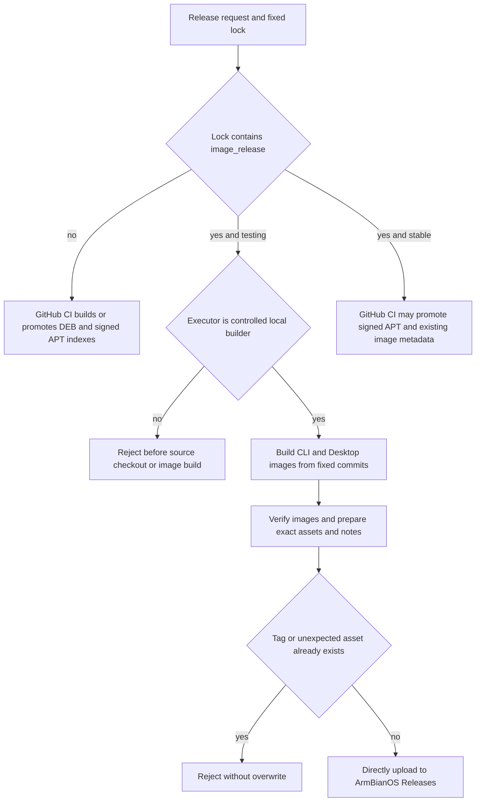

# Build complete images locally and publish them directly

## 需求与范围

The user requires complete ArmBianOS system images to be built on the controlled local builder and
uploaded directly to `dshanpi/ArmBianOS` Releases. GitHub-hosted Actions minutes are reserved for DEB,
signed APT index and promotion work. This applies to every release lock containing `image_release`,
including the pending DShanPI R1 and A1 CM5 `2026.10.10-1` image publications.

## 业务逻辑

An executor gate classifies a request by release operation, release-lock type and executor. A testing
request with a complete `image_release` plan is accepted only for the local executor. Package-maintenance
testing, APT promotion, withdrawal and purge remain available to GitHub-hosted Actions. Direct local
publication accepts only the exact fixed asset list, refuses an existing tag and never overwrites assets.

## 流程

## 安全与失败分支

- The GitHub workflow runs the executor gate before the expensive product build step.
- The local publisher rejects execution when `GITHUB_ACTIONS=true`.
- Asset names and counts must exactly match the immutable `image_release.assets` plan.
- An existing tag is a hard failure; direct publication never replaces or deletes Release assets.
- Build or upload failure is retained for operator review and is not automatically retried.
- APT signing keys remain in the CI signing path and are not required for direct image upload.

## 测试报告

| 类型 | 命令/检查 | 结果 | 证据 |
| --- | --- | --- | --- |
| Unit | `python3 -m unittest -v tests.test_release_executor` | PASS | Local test output |
| Cost gate | Image testing on `github-hosted` executor is rejected | PASS | Unit assertion |
| Local path | Image testing on `local` executor is accepted | PASS | Unit assertion |
| APT path | Maintenance testing and stable promotion remain CI-eligible | PASS | Unit assertion |
| Publisher | `bash -n scripts/publish-image-release-direct.sh` | PASS | Local syntax check |
| Repository | Full Python, shell, policy and change-record gates | NOT-RUN | Required before merge |
| Delivery | Direct R1 and CM5 image build/upload | NOT-RUN | Runs after merge |

## 未完成项

R1 and CM5 image assets have not yet completed their local builds. Successful direct publication does
not represent physical-board boot acceptance; their Releases remain prereleases until separately tested.

## 交付影响

Accidental complete-image builds can no longer consume GitHub-hosted Actions minutes. Package-only and
signed-index automation remains in GitHub CI/CD, while large image construction and upload use local
compute and the immutable ArmBianOS Release plan.
