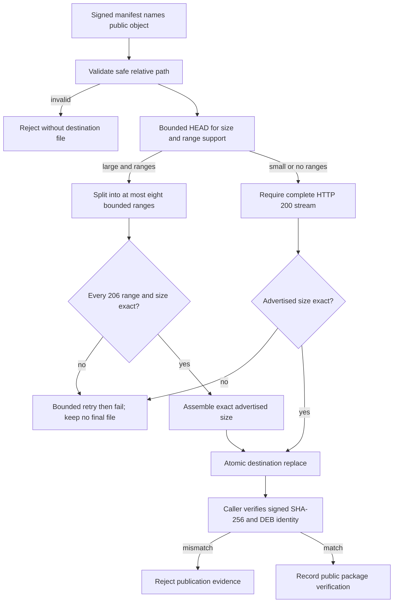

# Use one bounded downloader for public APT publication verification

## 需求与范围

Release housekeeping must finish with a reliable public-endpoint check. During the Avaota A1/T527
`2026.10.14-1` final synchronization, the public manifest signature passed but
`verify-product-public.py` reported a false `armbian-firmware` hash mismatch: the CDN returned an
initial partial response for the 164 MB object and the verifier treated it as a complete file.

This change makes both signed-cohort image input and post-publication verification use one shared,
bounded HTTP downloader. It applies to all four products because the verifier and package fetcher are
shared. It does not change any DEB, release lock, APT index, image, package version or stable state.

## 业务逻辑

The downloader accepts only safe relative repository paths. It requires a positive advertised object
size from a bounded HEAD request and reads its range capability. Objects at least 8 MiB are split across at most eight
bounded workers when byte ranges are available; each response must be HTTP 206, select the requested
range and produce the exact part size. Smaller or non-range objects require HTTP 200 and the exact
advertised complete size. All paths use bounded retries and a temporary destination;
only a complete file is atomically made visible. The caller still performs the signed SHA-256 and DEB
identity checks before accepting a package.

## 流程

## 安全与失败分支

- Absolute paths, traversal, non-normalized relative paths and empty paths are rejected before network
  or filesystem acceptance.
- Range workers are capped at eight; timeouts, retries and exponential waits remain bounded.
- HTTP 206 is mandatory for range requests and `Content-Range` must match the exact requested
  byte interval and advertised object size. HTTP 200 is mandatory for the non-range route.
- A partial stream, wrong advertised size, wrong final SHA-256 or wrong DEB identity is a hard failure.
- Temporary and range-part files never become the final destination until the complete size is present.
- Publication verification does not retry a release operation, mutate APT, promote stable or overwrite
  historical package bytes.

## 测试报告

| 类型 | 命令/检查 | 结果 | 证据 |
| --- | --- | --- | --- |
| Reproduction | Original `python3 scripts/verify-product-public.py avaota-a1 2026.10.14-1` | FAIL as expected | Signature valid, then false firmware hash mismatch after a 5 MiB partial response |
| HTTP evidence | HEAD and explicit Range request for public firmware DEB | PASS | HEAD advertises 164,280,264 bytes and ranges; explicit request returns exact HTTP 206 `Content-Range` |
| Unit partial-response route | `python3 -m unittest -v tests.test_public_repository_download` | PASS | 9 MiB fixture whose plain GET returns only 5 MiB is reconstructed from exact ranges |
| Signed cohort regression | `python3 -m unittest -v tests.test_fetch_public_release` | PASS | Exact signed cohort, tamper rejection and extra-package rejection remain valid |
| Python/syntax | `python3 -m py_compile` for all three affected scripts | PASS | Local main worktree |
| Whitespace | `git diff --check` | PASS | Local main worktree |
| Public Avaota cohort | Fixed verifier against `https://apt.100ask.net` | BLOCKED | 2026-10-16: signature and first two package hashes pass; large-object transfer remains incomplete; see source-cleanup record |
| Full regression | `python3 -m unittest discover -s tests -v` and `bash tests/test.sh` | PASS | 71 unit tests and `dshanpi-build tests passed` |
| Hardware | Physical board test | NOT-RUN | Downloader-only change; no package or board payload changed |

## 未完成项

The original public Avaota cohort recheck was pending at record creation. The 2026-10-16 attempt
verified its signature and two complete packages, but did not complete the large-object transfer;
full public-cohort acceptance remains outstanding before merge. This change does not add new hardware evidence and does not alter the existing
prerelease/stable decisions.

2026-10-16 follow-up: the complete 12-package Avaota public cohort passed signature, SHA-256
and DEB identity checks after the download-recovery/cache changes. The original failed or incomplete
attempts remain recorded above; see `CR-2026-10-16-download-recovery.md` and its full public log
for the completion evidence. This closes the public-cohort prerequisite before review.

## 交付影响

Post-publication verification now consumes public objects with the same bounded transport semantics as
local image assembly, eliminating a duplicate downloader and preventing partial CDN responses from being
misreported as corrupt signed packages. Because installed bytes and dependencies are unchanged, no new
Debian version or APT publication is required; this is a verifier/automation revision only.
