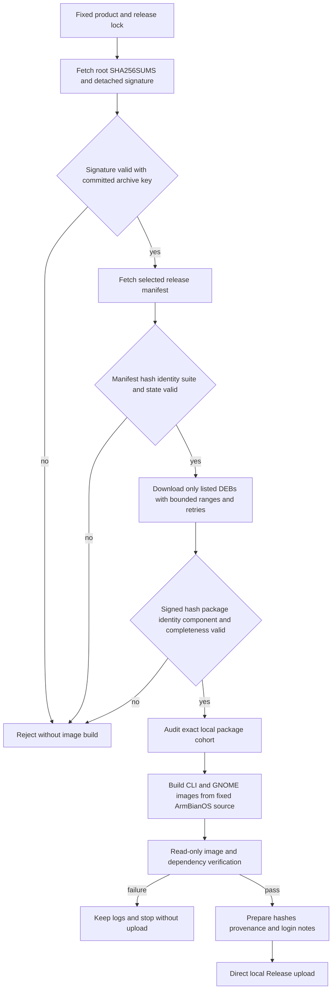

# Assemble local images from the exact signed public DEB cohort

## 需求与范围

The user requires DEB/APT work to remain in GitHub CI/CD while complete images are built and uploaded by
the controlled local builder. Local image assembly must consume exactly the public package bytes produced
by CI, without downloading the entire near-capacity Pages snapshot or rebuilding same-version DEBs.
This applies to Avaota A1/T527 `2026.10.14-1` and future complete image releases.

## 业务逻辑

The `--images-only` build mode fixes both source commits from the release lock, verifies the archive
public key against the root `SHA256SUMS.asc`, verifies the selected release manifest hash against that
signed root, and downloads only the package paths named by that manifest. Every DEB must also be named in
the signed root, match both SHA-256 records and expose the declared package/version/architecture. Required
product packages and both release metadata packages must be present before audit and image assembly.
Large immutable files use bounded parallel HTTP ranges and five bounded retries; all final bytes are
still accepted only after the signed SHA-256 check. An interrupted download can resume the overall cohort
operation by reusing already complete files only when their signed hashes match; mismatched or extra DEBs
remain hard failures.

## 流程

## 安全与失败分支

- Only HTTP(S) repository origins, safe relative paths, `common` plus the selected product component and
  `arm64`/`all` architectures are accepted.
- Unknown, duplicate, missing, withdrawn, cross-product or unsigned manifest/package records stop work.
- Downloads write temporary files and become visible only after completion; retry count is bounded and
  final acceptance never relies on transport success alone.
- A repeated invocation reuses already verified package files, rejects changed or extra DEBs and does not
  silently overwrite local bytes.
- `--images-only` does not rebuild or rewrite DEBs and cannot silently substitute local same-version bytes.
- Existing Release tags/assets remain protected by the direct-publisher no-overwrite gate.
- Image verification remains software-only until separate Avaota A1 physical-board evidence exists.

## 测试报告

| 类型 | 命令/检查 | 结果 | 证据 |
| --- | --- | --- | --- |
| Unit success | `python3 -m unittest -v tests.test_fetch_public_release` | PASS | Exact signed cohort fetched from local HTTP fixture |
| Unit tamper | Same suite with post-signing DEB mutation | PASS | Checksum mismatch rejected |
| Unit resume | Repeat fetch into populated package directory | PASS | Signed files reused; unsigned extra rejected |
| Syntax | `bash -n scripts/build-product.sh` and Python compile | PASS | Local output |
| Regression | `python3 -m unittest discover -s tests -v` | PASS | 68 tests passed locally |
| Integration | `bash tests/test.sh` | PASS | `dshanpi-build tests passed` |
| Public cohort | Avaota A1 signed download | IN-PROGRESS | `https://apt.100ask.net` |
| Image build | Avaota A1 CLI/GNOME images | NOT-RUN | Runs after merge |
| Hardware | Avaota A1 boot and peripherals | NOT-RUN | No board evidence supplied |

## 未完成项

The public cohort download and both local images remain in progress. Successful signed download and
read-only image validation do not constitute physical-board acceptance or stable promotion.

## 交付影响

The recurring release path now has a byte-exact boundary between CI-produced APT packages and locally
assembled images. It avoids both Actions image minutes and whole-repository downloads while retaining
cryptographic package provenance and the fixed-image/later-APT-update customer model.
