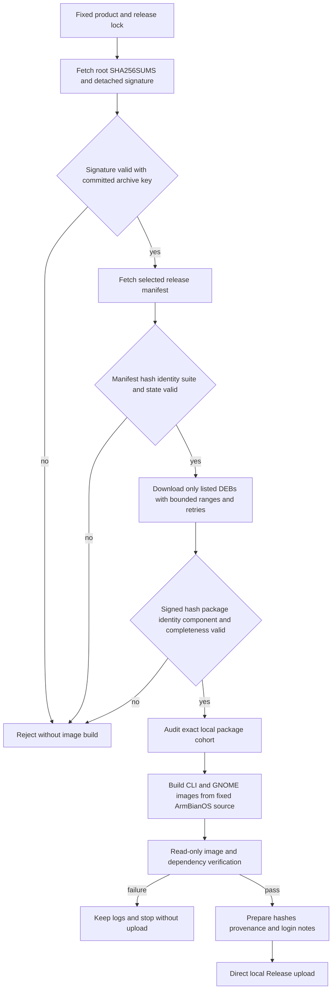

# Assemble local images from the exact signed public DEB cohort

## 需求与范围

The user requires DEB/APT work to remain in GitHub CI/CD while complete images are built and uploaded by
the controlled local builder. Local image assembly must consume exactly the public package bytes produced
by CI, without downloading the entire near-capacity Pages snapshot or rebuilding same-version DEBs.
This applies to Avaota A1/T527 `2026.10.14-1` and future complete image releases.

## 业务逻辑

The `--images-only` build mode fixes both source commits from the release lock, verifies the archive
public key against the root `SHA256SUMS.asc`, verifies the selected release manifest hash against that
signed root, and downloads only the package paths named by that manifest. Every DEB must also be named in
the signed root, match both SHA-256 records and expose the declared package/version/architecture. Required
product packages and both release metadata packages must be present before audit and image assembly.
Large immutable files use bounded parallel HTTP ranges, per-range offsets and five bounded retries; all final bytes are
still accepted only after the signed SHA-256 check. An interrupted download can resume the overall cohort
operation by reusing already complete files only when their signed hashes match; mismatched or extra DEBs
remain hard failures.

Image-only assembly accepts both normal clones and Git worktrees while still requiring the exact locked
commit and a clean tracked source. A temporary, guarded Armbian `userpatches/lib.config` prevents kernel
source rebuild only while the exact signed release cohort is installed by the release meta-package; the
file is removed on every exit path. Signed firmware, base-files and BSP bytes are also seeded into their
normal revisioned Armbian caches, and a same-name cache entry with different bytes is a hard failure.
Armbian's temporary `generic` image names are normalized only to the immutable names already fixed by the
release lock, after checking the original checksum sidecar. The image verifier mounts a separate FAT boot
partition read-only when present and validates either `armbianEnv.txt` or the single DTB selected by
`extlinux.conf`.

## 流程

## 安全与失败分支

- Only HTTP(S) repository origins, safe relative paths, `common` plus the selected product component and
  `arm64`/`all` architectures are accepted.
- Unknown, duplicate, missing, withdrawn, cross-product or unsigned manifest/package records stop work.
- Downloads write temporary files and become visible only after completion; retry count is bounded and
  final acceptance never relies on transport success alone.
- Incomplete range files remain temporary and resume at their exact byte offsets; they are deleted only
  after all ranges assemble to the advertised full size.
- A repeated invocation reuses already verified package files, rejects changed or extra DEBs and does not
  silently overwrite local bytes.
- `--images-only` does not rebuild or rewrite DEBs and cannot silently substitute local same-version bytes.
- An existing caller-owned Armbian `userpatches/lib.config` is never overwritten, and the temporary
  image-only override is removed after success or failure.
- Separate boot partitions are mounted read-only; missing, ambiguous, outside-`/dtb` or wrong-board
  extlinux DTB selections fail validation.
- Existing Release tags/assets remain protected by the direct-publisher no-overwrite gate.
- Image verification remains software-only until separate Avaota A1 physical-board evidence exists.

## 测试报告

| 类型 | 命令/检查 | 结果 | 证据 |
| --- | --- | --- | --- |
| Unit success | `python3 -m unittest -v tests.test_fetch_public_release` | PASS | Exact signed cohort fetched from local HTTP fixture |
| Unit tamper | Same suite with post-signing DEB mutation | PASS | Checksum mismatch rejected |
| Unit resume | Repeat fetch into populated package directory | PASS | Signed files reused; unsigned extra rejected |
| Boot layout | `python3 -m unittest -v tests.test_image_root` | PASS | `armbianEnv.txt` and T527 `extlinux.conf` DTB routes validated |
| Caller config | Images-only build with pre-existing `userpatches/lib.config` | PASS | Build refused and caller-owned sentinel remained byte-for-byte present |
| Syntax | `bash -n scripts/build-product.sh` and Python compile | PASS | Local output |
| Regression | `python3 -m unittest discover -s tests -v` | PASS | 70 tests passed locally |
| Integration | `bash tests/test.sh` | PASS | `dshanpi-build tests passed` |
| Public cohort | Avaota A1 signed download | PASS | 12 exact DEBs from `https://apt.100ask.net` and signed manifest |
| CLI image | Build plus read-only inspection | PASS | 3,200,253,952 bytes; SHA-256 `79a9fae0a562f7c1a9103e54e8c164b353af81d29b458085c537a66b7569c8f4` |
| GNOME image | Build plus read-only inspection | PASS | 4,831,838,208 bytes; SHA-256 `7a5464660a1d609406c5508b67c4ee3764ea1b13399d4ccbe3336bbd27d3c607` |
| Image cohort | `verify-image.sh` on both fixed-name images | PASS | Core/desktop meta `2026.10.14-1`, exact dependencies, T527 DTB and signed source present |
| Hardware | Avaota A1 boot and peripherals | NOT-RUN | No board evidence supplied |

## 未完成项

Both local images and their software-only read-only validation are complete. SyterKit `v0.4.0.6` was the
upstream bootloader payload selected by the locked ArmBianOS build logic and recorded in the local build
log; a future release gate should pin that external artifact rather than continuing to resolve a mutable
`latest` value. Successful signed download and read-only image validation do not constitute physical-board
acceptance or stable promotion.

## 交付影响

The recurring release path now has a byte-exact boundary between CI-produced APT packages and locally
assembled images. It avoids both Actions image minutes and whole-repository downloads while retaining
cryptographic package provenance and the fixed-image/later-APT-update customer model.
