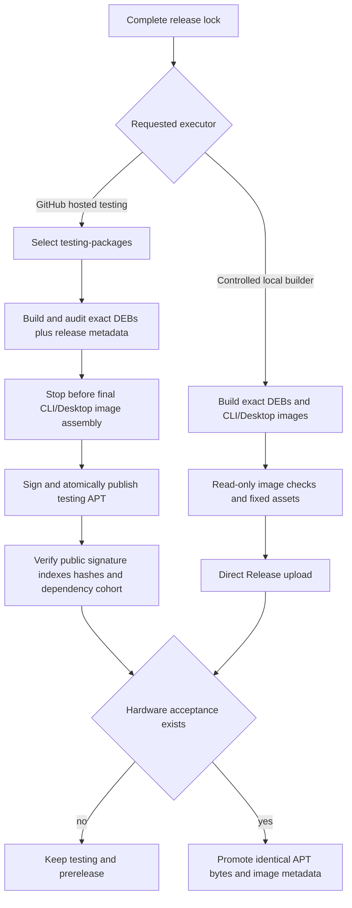

# Split signed APT publication from local complete-image construction

## 需求与范围

The user requires complete ArmBianOS images to consume only the controlled local builder while DEB
construction, repository signing and APT publication may use GitHub CI/CD. A complete image release lock
must therefore have a CI path that publishes its exact package cohort without preparing, retaining or
uploading system images. This applies to Avaota A1/T527 and every future complete image release.

## 业务逻辑

For a testing request containing `image_release`, the GitHub workflow selects the typed
`testing-packages` operation. It validates the complete image plan but invokes `build-product.sh` in
`--packages-only` mode. That mode calls only the kernel, firmware, base-files and board BSP artifact
commands, then stops after package audit, exact release metadata and `SHA256SUMS`; it never enters the
rootfs/image assembler. The workflow signs,
deploys and publicly verifies the APT cohort. The local executor continues to use the normal full mode
to assemble and validate CLI/Desktop images from the same lock and public package cohort. Stable still
promotes already tested bytes and existing image metadata without rebuilding either side.

## 流程

## 安全与失败分支

- GitHub-hosted `testing` remains forbidden for image construction; only the explicit typed
  `testing-packages` operation accepts a complete image lock.
- `testing-packages` rejects maintenance or legacy locks, preventing an ambiguous execution route.
- Package-only mode still performs source pinning, package collection, immutable-byte reuse, audit,
  exact core/desktop metadata and SHA-256 generation before it may publish.
- Package-only mode invokes only explicit Armbian artifact commands and cannot assemble a rootfs or image.
- APT public verification is a separate required job for both image and package-only releases.
- Build, signing, Pages deployment or public verification failure stops downstream image metadata work;
  no automatic retry or overwrite is introduced.
- The local Release publisher retains exact-asset and existing-tag rejection.

## 测试报告

| 类型 | 命令/检查 | 结果 | 证据 |
| --- | --- | --- | --- |
| Unit | `python3 -m unittest -v tests.test_release_executor` | PASS | Four executor-path assertions |
| Regression | `python3 -m unittest discover -s tests -v` | PASS | 66 tests passed locally |
| Integration | `bash tests/test.sh` | PASS | `dshanpi-build tests passed` |
| Syntax | `bash -n scripts/build-product.sh scripts/publish-image-release-direct.sh` | PASS | Local command output |
| Workflow | Parse `.github/workflows/release.yml` with PyYAML | PASS | Local command output |
| Workflow CI | `Validate APT tooling` | NOT-RUN | Required before merge |
| Delivery | Avaota A1 `2026.10.14-1` testing APT publication | NOT-RUN | Runs after merge |

## 未完成项

The Avaota A1 package cohort has not been built or published at record creation time. Package-only CI
does not replace local image verification or physical-board acceptance.

## 交付影响

Future complete releases use one immutable lock while paying GitHub Actions only for authorized DEB/APT
work. Large image construction and upload remain local, and package-only releases still receive an
explicit public endpoint verdict before completion.
