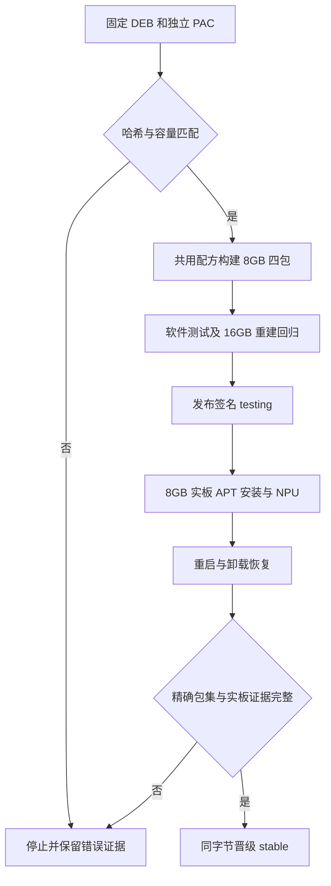

# AX8850 8GB 独立软件包

## 需求与范围

REQ-AXCL-8GB-001：使用用户提供的 AXCL V3.16.0 ARM64 DEB 和 8GB 4266 PAC，
新增 A1 8GB 四包与 APT 安装入口。REQ-AXCL-8GB-002：复用普通用户权限修复，
验证新刷 DShanPI A1 实板的安装、设备识别、NPU、重启和卸载恢复，更新源码。
不修改内核、BSP、16GB 已发布字节或客户文档网站；不生成新镜像。

## 业务逻辑

以 SHA 固定两个独立输入；原厂 DEB SHA 为
332d6a4043d39f31446e80b73e113dafbc2e30448e50a99e41e96ddf584aa33c；
所选 PAC SHA 为 4d3f5b7ff3871b0b16aa894e7ca9e26f842b3a27f5f04ce14acd1a90b0861ade。
内嵌 PAC 为另一哈希，不作为默认输入。8GB 四包全套同版本，精确绑定平台内核与头文件，
与 16GB 和旧 generic 包互斥。容量入口共用打包实现与权限模板，不隐式识别或更换容量。
维护发行从上一 stable 验签快照复用无关包，新增四包和发行元包。只对变更的 8GB 容量
要求新实板证据，16GB 字节必须保持一致；其他 A1 CM5、R1、Avaota A1 不增加该组件。

## 流程

## 安全与失败分支

错误 PAC、容量混装、平台依赖不符或历史包哈希变化均停止。安装不自动启动 NPU。
用户确认已重刷系统和连接 8GB 卡，本次独立固定 SSH 主机密钥；风扇开启后才做推理。
若推理导致设备异常，保存日志并按已授权方式 SSH reboot；无法恢复则报告硬件阻断。
发布使用既有 Actions 签名与串行队列；无凭据入库、不跳过验签、不覆盖历史同名包。
首次 8GB 没有上一 8GB 版本，回滚测试恢复到无 AXCL 的原始软件状态；不在 8GB 卡上
初始化 16GB 固件。可重试下载和可恢复安装，不能把未验证的结果写为 PASS。

## 测试报告

| 类型 | 命令/检查 | 结果 | 证据 |
| --- | --- | --- | --- |
| 输入 | SHA-256 与固定厂商元数据 | PASS | upstream.lock.json |
| 构建 | build-axcl-8g-packages.py；audit-packages.sh | PASS，4 包 | release lock expected hashes；output/8gb-candidate |
| 实板预检 | uname、lspci、headers、id | PASS，PCIe 1f4b:0650，内核与 headers 匹配，render 已加入 | 独立测试记录 01-board-discovery |
| 软件 | Python/Shell、容量门禁、16GB 重建 | PASS，84 Python tests + Shell；16GB 四包字节不变；8GB 两种 PAC 输入重建一致 | output/8gb-validation；精确包哈希见 release lock |
| 实板候选 | 新装、普通用户 SMI/NPU、重启恢复 | PASS，7040 MiB CMM；两次 20/20，41°C/40°C | 独立记录 03-install、04-npu、06-reboot-check；原始证据随后单独提交 |
| 公开 APT | testing、公开源安装、卸载恢复、stable | NOT-RUN，尚未发布 | 后续验收提交记录 |

## 未完成项

当前软件回归和首次实板安装、NPU、重启已通过；仍须完成签名 testing 发布、公开安装与卸载恢复验证。
只有绑定 exact manifest 的有效实板证据通过后才可晋级 stable。8GB 模型长稳和其他板型
硬件不在此次安装包验收范围内；客户网站保持不变。

## 交付影响

新增 packages/axcl-8g 与短期分支，通过 PR 更新 dshanpi-build。共享打包实现需证明
16GB 已发布包字节不变；不修改 ArmBianOS、dspi-config，也不触碰同事原工作区脏文件。
后续完整镜像仍按原有 16GB 路径构建，8GB 由明确的包维护入口发布，不自动装进镜像。
