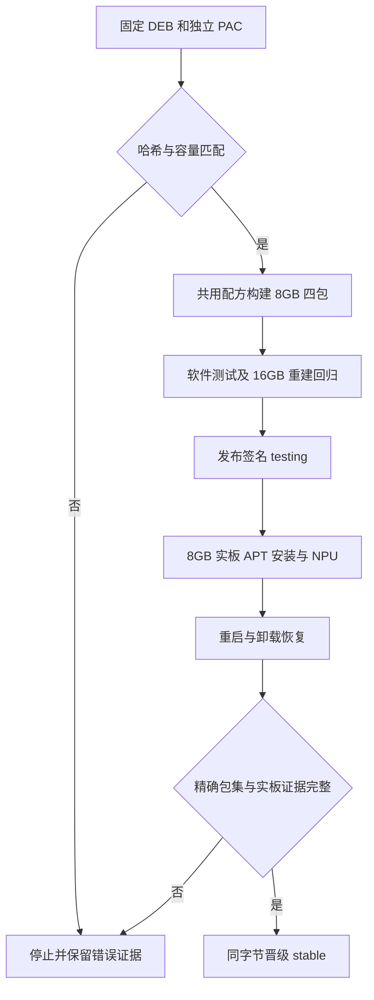

# AX8850 8GB 独立软件包

## 需求与范围

REQ-AXCL-8GB-001：使用用户提供的 AXCL V3.16.0 ARM64 DEB 和 8GB 4266 PAC，
新增 A1 8GB 四包与 APT 安装入口。REQ-AXCL-8GB-002：复用普通用户权限修复，
验证新刷 DShanPI A1 实板的安装、设备识别、NPU、重启和卸载恢复，更新源码。
不修改内核、BSP、16GB 已发布字节或客户文档网站；不生成新镜像。

## 业务逻辑

以 SHA 固定两个独立输入；原厂 DEB SHA 为
332d6a4043d39f31446e80b73e113dafbc2e30448e50a99e41e96ddf584aa33c；
所选 PAC SHA 为 4d3f5b7ff3871b0b16aa894e7ca9e26f842b3a27f5f04ce14acd1a90b0861ade。
内嵌 PAC 为另一哈希，不作为默认输入。8GB 四包全套同版本，精确绑定平台内核与头文件，
与 16GB 和旧 generic 包互斥。容量入口共用打包实现与权限模板，不隐式识别或更换容量。
维护发行从上一 stable 验签快照复用无关包，新增四包和发行元包。只对变更的 8GB 容量
要求新实板证据，16GB 字节必须保持一致；其他 A1 CM5、R1、Avaota A1 不增加该组件。

## 流程

## 安全与失败分支

错误 PAC、容量混装、平台依赖不符或历史包哈希变化均停止。安装不自动启动 NPU。
用户确认已重刷系统和连接 8GB 卡，本次独立固定 SSH 主机密钥；风扇开启后才做推理。
若推理导致设备异常，保存日志并按已授权方式 SSH reboot；无法恢复则报告硬件阻断。
发布使用既有 Actions 签名与串行队列；无凭据入库、不跳过验签、不覆盖历史同名包。
首次 8GB 没有上一 8GB 版本，回滚测试恢复到无 AXCL 的原始软件状态；不在 8GB 卡上
初始化 16GB 固件。可重试下载和可恢复安装，不能把未验证的结果写为 PASS。

## 测试报告

| 类型 | 命令/检查 | 结果 | 证据 |
| --- | --- | --- | --- |
| 输入 | SHA-256 与固定厂商元数据 | PASS | upstream.lock.json |
| 构建 | build-axcl-8g-packages.py；audit-packages.sh | PASS，4 包 | release lock expected hashes；output/8gb-candidate |
| 实板预检 | uname、lspci、headers、id | PASS，PCIe 1f4b:0650，内核与 headers 匹配，render 已加入 | 独立测试记录 01-board-discovery |
| 软件 | Python/Shell、容量门禁、16GB 重建 | PASS，84 Python tests + Shell；16GB 四包字节不变；8GB 两种 PAC 输入重建一致 | output/8gb-validation；精确包哈希见 release lock |
| 实板候选 | 新装、普通用户 SMI/NPU、重启恢复 | PASS，7040 MiB CMM；两次 20/20，41°C/40°C | 独立记录 03-install、04-npu、06-reboot-check；原始证据随后单独提交 |
| 公开 APT | testing、公开源安装、卸载恢复、stable | NOT-RUN，尚未发布 | 后续验收提交记录 |

## 未完成项

软件回归、公开 APT 安装、NPU、重启、上一 stable 回滚和重装均通过；后续批准清理已解除容量阻断，默认 noble 发布完成。历史阻断证据保留在下文。
只有绑定 exact manifest 的有效实板证据通过后才可晋级 stable。8GB 模型长稳和其他板型
硬件不在此次安装包验收范围内；客户网站保持不变。

## 交付影响

新增 packages/axcl-8g 与短期分支，通过 PR 更新 dshanpi-build。共享打包实现需证明
16GB 已发布包字节不变；不修改 ArmBianOS、dspi-config，也不触碰同事原工作区脏文件。
后续完整镜像仍按原有 16GB 路径构建，8GB 由明确的包维护入口发布，不自动装进镜像。

## 最终候选验收与发布阻断

实现 PR #52 已合并，构建源为 8845b312324a9641a5b3142c9a372f6471d9268b。
Actions 38707613018 完成四包构建、精确哈希比对、包审计及签名 testing 组装，在
publish-pages 的 snapshot encode 阶段因超过 950,000,000 字节预算停止，未推送或部署
新公开快照。当前公开 noble/noble-testing 均仍只有 16GB AXCL 四包。

| 类型 | 命令/检查 | 结果 | 证据 |
| --- | --- | --- | --- |
| 实板候选 | apt install 本地四包；普通用户 axcl-smi/axcl_ut_npu | PASS，7040 MiB CMM，20/20，10124 ms，41°C | docs/validation/2026-10-15-axcl-8gb/board.log |
| 重启 | SSH reboot，自动初始化，普通用户 NPU | PASS，20/20，10090 ms，40°C | 同上，06-reboot-check |
| 卸载恢复 | 停用服务，purge 四包，reboot | PASS，恢复无 AXCL 状态；PCIe 仍枚举，平台包未改 | 同上，07/08 |
| 容量互斥 | apt-get -s 同时请求 8GB/16GB | PASS，APT 拒绝冲突；未在 8GB 卡运行 16GB PAC | 同上，08 |
| 重装 | apt install 本地四包，普通用户 NPU | PASS，20/20，10186 ms，40°C；板端保留 8GB 环境 | 同上，11 |
| 云端复现 | 比较 Actions packages artifact 与本地 build.json | PASS，四包哈希相同 | Actions 38707613018 artifact dshanpi-a1-2026.10.15-3-packages |
| 公开发布 | publish-pages.sh / snapshot.py encode | BLOCKED，总仓库超预算至少 26,431,969 字节 | Actions 38707613018 failed step |
| 公网安装 | 从 noble/testing 按包名安装 8GB | NOT-RUN，公开源尚无该包 | 上述失败发生在公开快照切换之前 |

8GB 四包总计 50,000,632 字节，16GB 四包为 50,003,704 字节；拆分、权限和精确依赖规则
一致，输入容量及固件独立固定。已有仓库共 926,431,337 字节，其中 pool 为 926,076,854；
大体积文件主要是历史 CM5 内核/头文件/DTB、armbian-firmware，而不是 8GB 单包膨胀。
DNS CNAME 和公开 HTTP Server 确认 apt.100ask.net 当前由 GitHub Pages 承载。

未削减历史 pool、不提高容量保护阈值、不修改源或签名规则。没有生成 passed 的正式
hardware-acceptance.json，避免将本地 DEB 验证冒充公开 APT 验收。后续需确定仓库存储
容量方案，再恢复 testing 发布、公开 APT 安装、发行元包升级回滚及 stable 晋级。
技术证据记录准确状态；客户网站未变，独立指南提供候选 DEB 安装路径。

## 公开发布接续

用户已批准精确清理两个 CM5 旧测试版本。清理经 PR #54、Actions 38714370425 完成，
保留的 21 个 CM5 包和其他产品包哈希不变；旧字节已经备份。此操作解除此前容量阻断，
不改变 950 MB 门禁，不重新定义 8GB 包。

A1 testing 发布任务 38714648985 已成功，包含 30 个精确包；四个 8GB 包与此前候选哈希
一致，原有平台和 16GB 字节全部保留。testing manifest SHA-256 为
`67d5c927b2f4da95065d35dd0d36cd323b1f27880f2987140794b29193e358c6`。
以上历史“未发布/阻断”段落描述首次候选阶段，不再代表当前 testing 状态。

公网 APT 安装和普通用户 NPU、SSH 重启、发行元包回滚、恢复安装正在单独记录。
stable 晋级仍以提交的 hardware-acceptance.json 及其固定日志哈希为门禁，不提前宣布成功。

### 公网硬件验收完成

| 类型 | 命令/检查 | 结果 | 证据 |
| --- | --- | --- | --- |
| 公开源 | signed testing manifest、DEB 下载哈希 | PASS，四包 SHA 与候选一致；平台与 16GB 字节保留 | Actions 38714648985；hardware-acceptance.json |
| APT 安装 | apt-get install --reinstall 精确 8GB 四包和 release-desktop | PASS，从 apt.100ask.net 下载；22 个已装 cohort 包版本吻合 | hardware-acceptance/board.log，15、17 |
| 普通用户 | axcl-smi、axcl_ut_npu | PASS，7040 MiB CMM；20/20，10120 ms，41°C | 同上，15 |
| 重启恢复 | SSH reboot 后服务与 NPU | PASS，自动初始化；20/20，10121 ms，41°C | 同上，16、17 |
| 实板回滚 | 卸载四包并回到上一 stable 2026.10.15-2，重启 | PASS，18 个已装 cohort 包匹配；无 AXCL 设备/模块，PCIe 仍枚举 | 同上，19、20 |
| 实板恢复 | APT 重装四包和 2026.10.15-3 | PASS，22 个已装 cohort 包匹配；20/20，10194 ms，39°C | 同上，21、22 |
| 权限与源 | 设备、日志权限及 /etc 源文件 SHA | PASS，root:render；设备/日志 0660、目录 2770；无手工权限覆盖；默认源未改 | 同上，15、21、22 |
| stable | 相同字节晋级默认源 | NOT-RUN，待本验收提交合并后触发 | 不提前声称默认源可用 |

正式验收文件：`products/dshanpi-a1/releases/2026.10.15-3.hardware-acceptance.json`；
日志路径在同级 `2026.10.15-3.hardware-acceptance/board.log`，SHA 由 JSON 固定。
首次索引查询遇到尚未更新的 CDN 缓存，重新刷新后签名和版本正常。另一次回滚模拟发现
原镜像 `camera-engine-rkaiq=6.6.3+dshanpi2` 不在公开索引，未执行该模拟计划；实际回滚
采用完整的上一 stable 包集 `2026.10.15-2` 并逐项核对，不把它描述为原镜像逐字节恢复。
板端最终保留 8GB 新版，服务 enabled/active。无其他板型、模型长稳或新镜像验收。

## 默认源交付完成

stable 任务 38716589966 成功，清单 SHA-256 为
`94ca89be6af2fb3c27a94e6140520c046c2dba7c84ac5a24f6c723779307f1bf`，
所有 30 个 testing 包哈希保持一致。晋级修改清单的 promoted_to 字段，因此正式验收
仍绑定原 testing manifest；不要改写已经完成的验收记录来迁就 stable 清单哈希。

| 类型 | 命令/检查 | 结果 | 证据 |
| --- | --- | --- | --- |
| 公开 stable | Actions verify-public-apt、GPG、testing/stable 包集比较 | PASS，全 30 包字节相同；旧 pool 字节不变 | docs/validation/2026-10-15-axcl-8gb-public/stable-verification.json |
| 默认源实板 | 仅镜像原有 noble 源 update、policy、入口包 reinstall、SMI、apt-get check | PASS，8GB candidate 优先级 500；16GB 保留；普通用户正常 | 同目录 default-noble.log |
| 安装边界 | 默认源阶段复用已核验的 APT 缓存重装入口包 | PASS；完整四包下载和全新安装在此前 testing 同字节验收完成 | hardware-acceptance/board.log 和 default-noble.log |

最终快照 513,404,560 字节、87 个 DEB；没有修改容量门禁或客户网站。默认源文件 SHA
仍为 9e00e649bd0c681e5f1836a2b7e2b9559d3f459e2f109d1afe9ee348f06d579a。
安装包任务交付完成。原镜像中未公开的 camera 包、其他板型和模型长稳仍不在此次验收范围。
