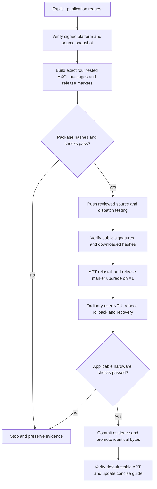

# Publish and validate AXCL 16GB ordinary-user access

## 需求与范围

REQ-AXCL-APT-PERMISSIONS-001: publish the hardware-tested permission repair through signed APT,
push source, reinstall from APT on DShanPI A1, and update the standalone concise guide.
Only A1 16GB changes. The A1 platform remains revision 25.11.0-trunk.20261010.1. Other products,
8GB packages, upstream driver/runtime/PAC payloads and image assets are not changed.

## 业务逻辑

The 2026.10.15-1 maintenance plan retains the signed 2026.10.14-1 platform/AIC bytes and builds
four AXCL 3.16.0+dshanpi.2026.10.15.1 packages plus new exact core/desktop markers. Historical
3.16.0+dshanpi2 source packages were removed from the current public snapshot before this work.
The new plan therefore pins the current signed 2026.10.10.1 source cohort. The builder verifies
identities, hashes, original upstream provenance and PAC hash before extracting it. It preserves
the component provenance installed by the already-tested candidate. Publication is rejected unless
all four generated hashes equal that candidate. Existing legacy build arguments remain supported.
No historical lock, package identity or signing policy is overwritten.

## 流程

## 安全与失败分支

User explicitly authorized source push and APT publication. Standard Actions signing and serial
publication remain in force; credentials stay outside Git. Changed hashes, missing source packages,
invalid signatures, incomplete cohorts or unexpected platform changes stop the operation. Testing
is published before stable; failed hardware checks leave the cohort in testing. Existing release
manifests and DEBs remain available for rollback. No manual device or log permission patch is used.
Unrelated colleague working-tree changes are excluded by working in a clean linked checkout.
The existing public-snapshot SSH transfer was too slow and stopped before any mutation; an HTTPS
proxy attempt failed TLS negotiation. Read-only snapshot download uses signed checksums and cached
bytes only after hashing; final full repository verification is still required.

## 测试报告

| 类型 | 命令/检查 | 结果 | 证据 |
| --- | --- | --- | --- |
| Static | policy, change record, hygiene, diff | Passed after correcting this record's table headings | local release log |
| Software | Python and Shell tests | PASS: 80 Python tests and Shell suite passed | output/permissions-release-python.log; output/permissions-release-shell.log |
| Build | build-maintenance-release.py dshanpi-a1 2026.10.15-1 | Pending identical-hash comparison | release build log to follow |
| Public | release.yml testing and verify-product-public.py | Not yet published | workflow run to follow |
| Board | signed APT install, ordinary-user SMI/NPU, reboot and rollback | Pending public cohort; local candidate previously passed | prior AXCL permission verification record |

## 未完成项

Testing publication, public APT install, release-marker acceptance, stable promotion and guide update
remain pending at implementation commit time. No new image or all-model stress validation is claimed.

## 交付影响

A1 16GB users in render gain ordinary-user device/log access from the package itself. The new release
marker binds the exact optional selector in Suggests without installing hardware software on systems
that have not selected it. Prior local candidate evidence is in docs/validation/2026-10-15-axcl-access/.
Formal public and board evidence will be committed separately with run IDs and signed manifest hashes.
