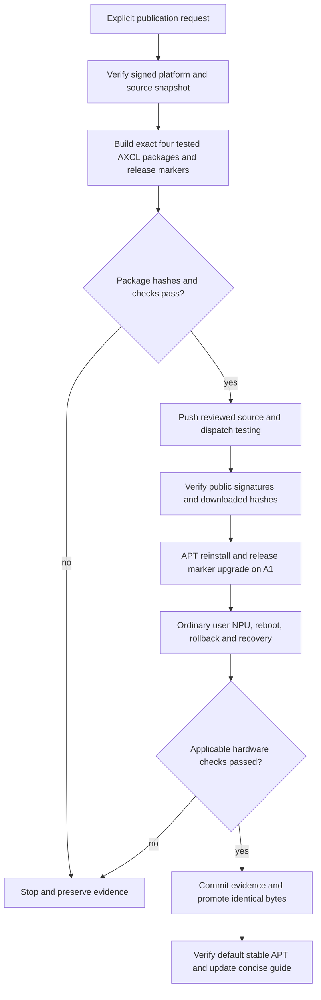

# Publish and validate AXCL 16GB ordinary-user access

## 需求与范围

REQ-AXCL-APT-PERMISSIONS-001: publish the hardware-tested permission repair through signed APT,
push source, reinstall from APT on DShanPI A1, and update the standalone concise guide.
Only A1 16GB changes. The A1 platform remains revision 25.11.0-trunk.20261010.1. Other products,
8GB packages, upstream driver/runtime/PAC payloads and image assets are not changed.

## 业务逻辑

The 2026.10.15-1 maintenance plan retains the signed 2026.10.14-1 platform/AIC bytes and builds
four AXCL 3.16.0+dshanpi.2026.10.15.1 packages plus new exact core/desktop markers. Historical
3.16.0+dshanpi2 source packages were removed from the current public snapshot before this work.
The new plan therefore pins the current signed 2026.10.10.1 source cohort. The builder verifies
identities, hashes, original upstream provenance and PAC hash before extracting it. It preserves
the component provenance installed by the already-tested candidate. Publication is rejected unless
all four generated hashes equal that candidate. Existing legacy build arguments remain supported.
No historical lock, package identity or signing policy is overwritten.

## 流程

## 安全与失败分支

User explicitly authorized source push and APT publication. Standard Actions signing and serial
publication remain in force; credentials stay outside Git. Changed hashes, missing source packages,
invalid signatures, incomplete cohorts or unexpected platform changes stop the operation. Testing
is published before stable; failed hardware checks leave the cohort in testing. Existing release
manifests and DEBs remain available for rollback. No manual device or log permission patch is used.
Unrelated colleague working-tree changes are excluded by working in a clean linked checkout.
The existing public-snapshot SSH transfer was too slow and stopped before any mutation; an HTTPS
proxy attempt failed TLS negotiation. Read-only snapshot download uses signed checksums and cached
bytes only after hashing; final full repository verification is still required.

## 测试报告

| 类型 | 命令/检查 | 结果 | 证据 |
| --- | --- | --- | --- |
| Static | policy, change record, hygiene, diff | Passed after correcting this record's table headings | local release log |
| Software | Python and Shell tests | PASS: 80 Python tests and Shell suite passed | output/permissions-release-python.log; output/permissions-release-shell.log |
| Build | build-maintenance-release.py dshanpi-a1 2026.10.15-1 | Pending identical-hash comparison | release build log to follow |
| Public | release.yml testing and verify-product-public.py | Not yet published | workflow run to follow |
| Board | signed APT install, ordinary-user SMI/NPU, reboot and rollback | Pending public cohort; local candidate previously passed | prior AXCL permission verification record |

## 未完成项

Testing publication, public APT install, release-marker acceptance, stable promotion and guide update
remain pending at implementation commit time. No new image or all-model stress validation is claimed.

## 交付影响

A1 16GB users in render gain ordinary-user device/log access from the package itself. The new release
marker binds the exact optional selector in Suggests without installing hardware software on systems
that have not selected it. Prior local candidate evidence is in docs/validation/2026-10-15-axcl-access/.
Formal public and board evidence will be committed separately with run IDs and signed manifest hashes.

## Reproducible metadata correction

Testing run 38692053088 stopped before signing/publication because the mandatory package-byte gate
failed. Local comparison found only runtime DEBIAN/control Installed-Size differed (100425 vs 100426
KiB); all installed file contents, permissions, owners and timestamps were identical. Imported control
metadata and the prior provenance file size had been included in the size calculation. The builder now
writes current provenance first and measures only installed regular files, excluding DEBIAN metadata.
A new component version 3.16.0+dshanpi.2026.10.15.2 and new release 2026.10.15-2 preserve the first
candidate and failed plan. Both historical source cohorts must produce identical four-package hashes.
The previous assertion of pending identical-byte reproduction is superseded by this recorded failure;
it was never a public release. The corrected cohort will receive fresh APT hardware acceptance.

The optional local whole-repository download was stopped after GitHub Actions had verified the full
signed snapshot, to avoid redundant transfers of unrelated board kernels. The local comparison inputs
came from the preserved board rollback files and matched the release plan's signed-public hashes.
Formal builds and publication continue to use the full verified Actions snapshot.

Correction validation: PASS, 81 Python tests and the Shell suite. Both source cohorts produced four
byte-identical 3.16.0+dshanpi.2026.10.15.2 DEBs; each passed package audit. Expected hashes are pinned
in the new 2026.10.15-2 lock. Historical 2026.10.15-1 lock and evidence remain unchanged. Build logs:
output/permissions-reproducible-python.log and output/permissions-reproducible-shell.log; package
manifests: output/reproducible-source-{current,original}/axcl-16g-build.json. Public APT and board
acceptance remain NOT-RUN for revision 2 at this implementation commit.

## Public testing and hardware acceptance

Testing release 2026.10.15-2 succeeded in Actions run 38692942310 from commit
62d967a0f62af3aaa209337bd0f73209283b2b5d. Signing, Pages deployment and public verification of all
26 DEBs passed. The signed manifest SHA-256 is
aa6bf062b149befb0755cbfbc9fc0ffac2f255a976487ab52cc0ab77c6d8141d.
Only four AXCL DEBs and two release markers changed; the other 20 package hashes match prior stable.

| 类型 | 命令/检查 | 结果 | 证据 |
| --- | --- | --- | --- |
| Public | release.yml testing; verify-product-public.py | PASS, 26 public DEBs and signature | Actions 38692942310 |
| Board APT | apt-get -t noble-testing install exact selector and desktop release | PASS, signed public download and four expected hashes | 2026.10.15-2.hardware-acceptance/board.log |
| Cohort | dpkg-query exact required desktop plus AXCL set | PASS, 22 installed packages match | same board log |
| Ordinary user | axcl-smi; axcl_ut_npu | PASS, 20/20, 10252 ms, 49 C | same board log |
| Reboot | SSH reboot; repeat ordinary-user NPU | PASS, 20/20, 10239 ms, 48 C | same board log |
| Rollback | exact 2026.10.14-1 desktop and old AXCL four-package APT downgrade; reboot | PASS, 22 package versions match; root NPU 20/20, 10129 ms | same board log |
| Recovery | APT restore 2026.10.15-2; reboot; ordinary-user NPU | PASS, 20/20, 10193 ms, 48 C | same board log |
| Evidence gate | validate-hardware-evidence.py against signed testing manifest | PASS, exact manifest and log hashes | 2026.10.15-2.hardware-acceptance.json |

The first testing install simulation omitted a target suite and was rejected because testing has
NotAutomatic priority 1. Selecting -t noble-testing resolved the exact dependency cohort. No package
was changed by the failed simulation. The test image also held older dspi-config/camera packages;
installing the exact release marker aligned them with the existing published platform base.
A slow download-only APT operation was interrupted before dpkg, then resumed through the user's
proxy. An _apt warning concerned the temporary cache under the tester's home, not AXCL access;
subsequent transactions used the system APT cache. Signatures and hashes were never bypassed.

No /etc permission overrides were present. New packages configure root:render devices and logs;
old-version ordinary-user Permission denied was deliberately reproduced after rollback, while its
root NPU test passed. This is expected historical behavior, not a claim that the old permission bug
was fixed. The board is restored to the new cohort. No 8GB, other-board, all-model or long-duration
hardware claim is made. Stable promotion and default-noble installation remain pending at this
acceptance commit; the promotion must reuse these exact bytes without rebuilding.
