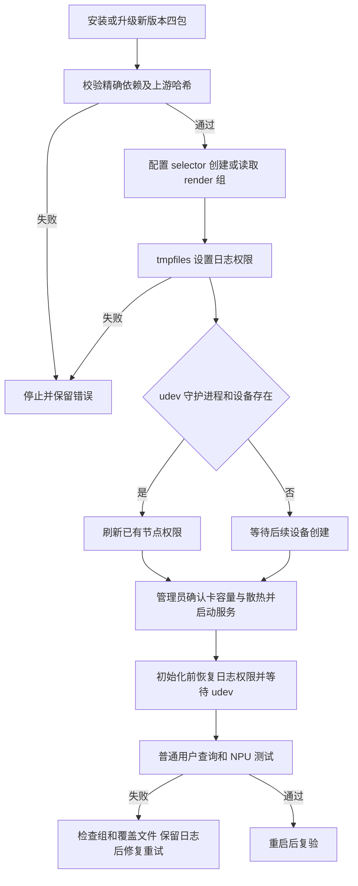

# AXCL 16GB 普通用户访问权限

## 需求与范围

REQ-AXCL-USER-ACCESS-001：用户授权访问维护虚拟机，阅读源码与发行手册后重构安装包，
解决普通用户 axcl-smi 的设备和日志 Permission denied。范围为 A1 的 16GB 可选包；
8GB 历史包、A1 CM5、R1、Avaota A1 的配方与硬件支持不变。无新硬件兼容声明。
用户授权构建和测试；本会话未授权签名发布或 stable 晋级，不操作公共仓库。

## 业务逻辑

权限配置由 selector DEB 拥有：udev 精确匹配四个 misc 节点，仅授权 render 组；
tmpfiles 创建/修正日志目录和文件，服务在初始化前再次应用并设置 UMask。
postinst 创建缺失的组，修复日志和当前节点，不加载驱动或启用服务。初始化命令等待
udev 完成后再查询设备。postrm 仅刷新规则/服务缓存，保留日志、成员关系和管理员覆盖。
管理员显式选择账号加入 render；默认镜像既有成员关系不修改。

组件包版本提高至 3.16.0+dshanpi.2026.10.15.1，驱动/固件来源和 SHA 不变，精确内核
依赖仍为 25.11.0-trunk.20261010.1。构建器拒绝使用更早包身份装入新权限内容；旧
发行 lock 不修改。维护与完整四包路径均由同一 selector 模板获得权限修复。

## 流程

## 安全与失败分支

不使用 chmod 777，不删除日志，不自动猜测和授权用户，不在安装阶段启动卡或模型。
组创建/tmpfiles/在线 udev 失败均中止 configure；解决根因后可重试 dpkg 配置。
离线镜像没有运行中的 udev/systemd 时跳过守护进程刷新，日志配置仍执行。
未知容量、PAC/ABI 不匹配仍由原检查拒绝。8GB 与 16GB 冲突关系不变。
不修改同事已有的 README 和下载器工作区变更；只暂存本次明确审查的文件。
重刷/回滚旧包会回到旧行为；正式回滚必须整套精确依赖一致，不能将 8GB 套件当回滚。

## 测试报告

| 类型 | 命令/检查 | 结果 | 证据 |
| --- | --- | --- | --- |
| 静态 | check-delivery-policy.py --peer 两个同级仓库；sh/bash -n | PASS | 本机任务证据 09-tests-build.json |
| 软件模拟 | unittest discover -s tests -p 'test_axcl*.py' | PASS，16 项；包括权限生命周期、ABI 和依赖 | tests/test_axcl_access.py；09-tests-build.json |
| 构建/包 | build-axcl-16g-packages.py，固定三个历史输入 SHA，完整四包 | PASS，4 包审计通过；当前内核精确绑定 | output/axcl-access-20261015/packages/axcl-16g-build.json |
| 负向 | 使用旧版 3.16.0+dshanpi.2026.10.10.1 请求新配方 | PASS，拒绝且未创建输出目录 | 11-audit.json |
| 软件回归 | unittest discover -s tests -p 'test_*.py'；bash tests/test.sh | PASS，79 项 Python 及 Shell 回归 | 10-regression.json |
| 构建/包 | 解包核对模板、0644/0755 权限、无 /etc 覆盖；对比历史 runtime/PAC | PASS，182 个运行时文件及 1 个 PAC 内容未变 | output/axcl-access-20261015/package-verification.json |
| 工作区门禁 | check-change-record.py | BLOCKED，同事已有未提交 CR-2026-10-14-public-verifier-range-download.md 缺少流程章节；本次记录单独校验 PASS | 12-docs.json；13-package-check.json |
| 干净源码 | 固定功能提交重新检出，运行三仓政策、变更记录及源码卫生门禁 | PASS | docs/validation/2026-10-15-axcl-user-access/verification.json |
| 干净源码回归 | unittest discover：77 项；bash tests/test.sh | PASS，与同事未提交文件隔离 | 同上；15-clean-regression.json |
| 可复现构建 | 固定提交重建四包并逐一比较 SHA256 | PASS，四包一致 | 同上；14-freeze.json |
| 实板初始连接 | 原板初次不可达；用户确认重新刷机后更新独立 SSH 密钥记录 | PASS，后续恢复连接；初始阻断已解除 | 本地 board/evidence/01-baseline.json |
| 实板升级与重启 | 四包升级；普通用户 SMI/NPU；SSH reboot 后同项检查 | PASS，两次均 20/20，无手工 /etc 补丁 | docs/validation/2026-10-15-axcl-user-access/hardware-verification.json |
| 实板重复配置 | 将现有节点与日志恢复旧权限，dpkg-reconfigure selector | PASS，权限自动修复，日志哈希不变 | 同上 existing_permissions_repair_log_preserved |
| 实板回滚 | 四包降级至旧版并重启，管理员 NPU 检查 | PASS，20/20；普通用户旧权限错误重新出现，符合旧版行为 | 同上 root_npu_after_rollback_reboot |
| 实板无包重装 | 停止服务、卸载模块、purge 四包后重新安装新四包 | PASS，无包状态已核对，日志保留，安装未自动启动服务 | 同上 purge_four_packages_then_install |
| 实板最终状态 | 新版重装及最后一次重启后的普通用户 SMI/NPU | PASS，两次均 20/20；最终保留新版并启用开机初始化 | 同上 nonroot_after_final_reboot |
| 公开端点 | testing 发布后验签与包下载 | NOT-RUN，本次未发布 | 不适用 |

## 未完成项

本次实板验证已完成升级、重复配置、重启、整套旧版回滚，以及清除四包后的重装和
最终重启。新刷镜像已预装旧版四包，因此“清除四包后重装”不是再次刷机后从零安装
所有系统依赖的验证。全程没有 /etc 手动权限补丁；长期业务负载和日志轮转压力未测。
正式 APT 发行需新 release lock、基础签名清单、精确元包、testing 发布及公共验证；
本次本地候选包不代表在线交付完成。其他板卡与 8GB 未执行硬件验证。

## 交付影响

仅修改 dshanpi-build 的 16GB 组件、构建器、测试和本记录。无需修改 ArmBianOS
内核/设备树或 dspi-config。8GB 不借此扩大支持范围；其历史包仍要求管理员访问。
本机候选与源码改动供评审，旧源包、历史 DEB、release lock 和 tag 均保留。
包进入正式 testing 并通过验收后，独立客户指南方可移除该新版本的手工权限配置。

功能提交：`847653d271e529ec29059d047c5283979e8dbe55`。候选包身份、哈希及验证范围保存在 [verification.json](../validation/2026-10-15-axcl-user-access/verification.json)。原始会话构建与测试日志已另存任务证据目录，不提交凭据或大文件。

## 实板复测补充

本次候选包仍为功能提交 847653d271e529ec29059d047c5283979e8dbe55 构建的相同四包，
未因实测重打包或变更 SHA256。最终板端保留 3.16.0+dshanpi.2026.10.15.1，
卡端 CMM 总量 15232 MiB。该实板结果支持本包权限修复，不表示已完成公共 APT 交付。

测试执行中遇到两项 APT 命令行为：相对本地路径配合 --no-download 报错，尚未安装；
改用绝对本地路径后成功。回滚同版本同时存在于在线源时，APT 优先下载远端包；在确认
未运行 dpkg 后中断下载，将已校验旧包放入 APT 缓存，以精确版本和 --no-download
完成离线回滚。两项均保留本地原始日志，没有关闭签名验证或改变软件源。
