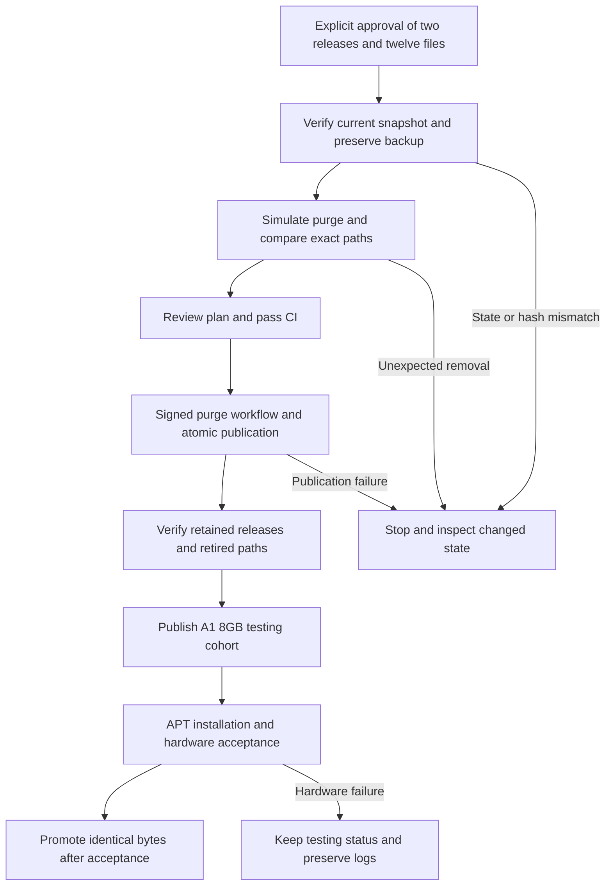

# Retire two reviewed CM5 testing cohorts

## 需求与范围

The user explicitly approved deletion of CM5 testing releases `2026.10.08-1` and
`2026.10.08-2` and their 12 exclusively referenced DEBs, followed by publication of
A1 AXCL 8GB. This is a narrow, approved exception to historical package retention.
Keep all 21 packages of CM5 `2026.10.09-1`, CM5 `2026.10.08-3`, all promoted releases,
A1 16GB, R1 and Avaota A1. No website, image, kernel source or signing policy changes.

## 业务逻辑

Use the existing signed purge workflow with plan `2026.10.15-1`. The active replacement
is CM5 `2026.10.09-1`. Remove references only from the two retired testing manifests;
remove pool bytes only when no remaining manifest or suite references them. The exact
reviewed paths and hashes are in `docs/validation/2026-10-15-cm5-retirement/reviewed-files.json`.
Expected savings: 463,021,314 bytes. This makes room for the already tested 50,000,632-byte
A1 8GB package set. The 950 MB gate remains unchanged.

## 流程

## 安全与失败分支

User approval is limited to the recorded 12 paths and two releases. No blanket deletion
by package name or age is allowed. Preserve downloaded SHA-256-verified backup payloads,
signed manifests and the source Pages state commit before dispatch. Protected Actions
secrets provide signing; no private keys are copied locally. Publication's existing base
state hash and Git concurrency protection prevent overwriting another publisher. On an
ambiguous result inspect public state before retrying; never rerun a completed purge.
If another release begins referencing an old path, do not widen removal to force savings.
Old CM5 users lose public reinstall access to the retired versions; backup remains available.
The pre-existing CM5 2026.10.10-1 missing headers URL is outside this approved operation.

## 测试报告

| 类型 | 命令/检查 | 结果 | 证据 |
| --- | --- | --- | --- |
| Static | `python3 tools/check-delivery-policy.py --peer ../ArmBianOS --peer ../dspi-config` | PASS | Local execution; no policy changes |
| Reference simulation | `repository_tool.py purge` on isolated metadata and placeholder pool copy | PASS: exactly 12 reviewed paths; retained manifests and noble catalogs unchanged | `docs/validation/2026-10-15-cm5-retirement/reviewed-files.json` |
| Dependency analysis | All retained public Packages exact Depends/Pre-Depends checked against removed identities | PASS: zero newly missing exact dependencies | Local `output/apt-cleanup-audit/analysis.json` |
| Backup | Download old payloads and signed metadata; compare with current snapshot SHA-256 | PASS: all 12 payload hashes verified; recoverable TAR backed up on build host and operator PC | Local `output/cm5-retirement-backup/` |
| Regression | Python and Shell suite | PASS: 84 Python tests and Shell suite | Local `output/cm5-retirement-python.log` and `output/cm5-retirement-shell.log` |
| Public / hardware | Purge publication and public A1 8GB install | PASS: purge 38714370425 and public checks; A1 8GB acceptance remains pending | `docs/validation/2026-10-15-cm5-retirement/public-verification.json` |

## 未完成项

Backup, regression checks and public purge are complete. A1 8GB publication,
APT hardware acceptance and stable promotion remain pending. No CM5,
R1 or Avaota hardware validation is implied by metadata/reference checks.

## 交付影响

Only reviewed CM5 testing history is retired. Current CM5 packages, all A1 stable packages
and other product metadata remain unchanged. A1 8GB retains the implementation and locked
package hashes merged in PR #52; this operation changes capacity availability, not DEB bytes.
ArmBianOS and dspi-config source are unchanged. Recovery uses the signed pre-purge snapshot
and verified backup through the normal reviewed signing/publication path.
