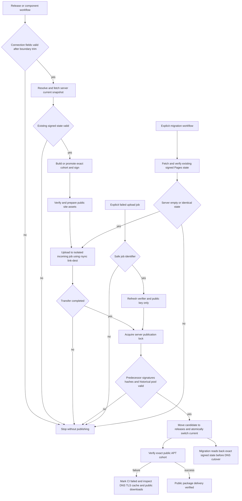

# Direct CI upload to the apt.100ask.net server

## 需求与范围

The user authorizes implementation of direct CI upload to `/www/wwwroot/apt.100ask.net/` using
`HOST`, `USERNAME`, `PASSWORD`, and `PORT`. Remove the previous hardcoded server layout and any
preinstalled custom importer dependency. Preserve automatic package audit, signing, immutable DEBs,
product isolation and public verification. This shared hosting change covers DShanPI A1, A1 CM5,
R1 and Avaota A1 and the three A1 optional-component entry points. No DEB bytes, release locks,
client package versions, signing trust, hardware acceptance rules or other repositories are changed.

## 业务逻辑

Gpgv output and verification-resume fix: `bf7b0b2cdd713fb2525c8e547f0cc368390cc4ef`.

Older-server compatibility fix: `d301ca9ff2122e1d7897420248d38ccf160d4377`.

Rsync authentication fix: `54c98bc55311b9deddf6f79b22412eb562abfb0c`.

Whitespace compatibility follow-up: `771b7598287435682fbeb5f5ad3f7586aef18583`.

Implementation commit: `8f0dbefc12a868ce205b210d059a4ca96315d6fb`.

`release.yml` defaults to SSH and is reusable by AXCL, AXCL 16GB and AIC entry points. Each release
resolves current to an immutable server snapshot, fetches and verifies that complete predecessor,
then uses the existing package/release builders and signing path. Signing fingerprints must match
the committed archive identity. The shared site preparation builds the browser index and public
key assets for both backends. SSH retains small signed metadata artifacts instead of repacking
and retaining the complete historical repository on every testing release.

Rsync is wrapped in exactly one sshpass process, while its remote shell is plain SSH. sshpass
scrubs SSHPASS in its child environment; nesting another copy would authenticate with the scrubbed
value. A real PTY/password-prompt regression reproduces that behavior without a network server.

SSH/rsync uses the four requested credentials, the new site root and a per-checkout known-hosts
file. An optional committed, independently verified host public key pins it across runners without
a fifth secret; otherwise the first observed key is accepted and later changes in that checkout fail.
Connection fields HOST, USERNAME and PORT are trimmed at their boundaries to tolerate pasted
spaces and CRLF. PASSWORD is opaque and preserved byte-for-byte. Migration validates these fields
before downloading repository history.

CI streams `ssh-repository.py` over SSH and uploads the existing verifier and public key alongside
the job's private control directory; the server installs no custom service or importer and CI uses
no sudo. Base packages Python 3.6+, rsync, gpg and gpgv must be installed on the server.

Rsync compares checksums and uses `--link-dest` to reuse identical previous files without retransmission
or duplicate DEB storage, even when candidate timestamps differ. It never uses inplace writes to
hard-linked live files. A server lock covers predecessor verification, signature/index/package checks,
history comparison and the atomic `current` symlink replacement. Old releases remain available on disk.
Only explicit signed purge removal lists may remove pool files from a new snapshot; no automatic
snapshot or history deletion is introduced. The web root is the `current` subdirectory. Remote initialization checks the Python version and
required tools before creating storage or transferring packages. The verifier quotes its generic
return annotation so Python before 3.9 can import the same verification code without evaluating
unsupported builtin generic types; signature and package checks are unchanged. Clear-signed plaintext is captured from gpgv stdout
instead of an already-created temporary output file, avoiding legacy overwrite behavior. Signature
failure diagnostics include the actual gpgv error; a signed-content mismatch is reported separately.
An optional migration resume_job updates only verifier/key control files in a known failed upload,
then performs all original checks against the locally fetched expected complete signed state. It
never rewrites the staged payload or skips its expected SHA256SUMS/signature/history checks.

The migration workflow reads and verifies the existing Pages snapshot, uploads those exact signed
bytes with an explicit bootstrap operation, then downloads and verifies the resulting server snapshot.
Bootstrap refuses to replace a different initialized state. Ordinary release refuses an empty server.
DNS/HTTPS changes remain administrator operations. The old Pages backend remains available explicitly
but SSH releases never write or encode its size-limited state.

## 流程

## 安全与失败分支

- Validate credential presence, host/user/port and path syntax. Never print passwords or pass them
  on command lines. The server needs deployment-directory write permission but no sudo.
- Fetch/SSH failures stop the workflow; never interpret them as an empty repository. Resolve the
  release path once, so an intervening current switch cannot mix snapshot downloads.
- Shared workflow concurrency prevents normal overlapping CI publication; the server lock and signed
  predecessor hash independently reject stale candidates. Rebuild from the latest state after a conflict.
- Local and server verification reject truncated payloads, invalid signatures, inconsistent indexes,
  missing site assets, historical byte replacements, unexpected removals and uploaded symbolic links.
- Upload failure or failure to replace current leaves the previous current intact. An orphan snapshot
  or incoming job is retained for diagnosis; no automatic cleanup risks deleting a live snapshot.
- The same signed checksum state is verified and treated as an idempotent retry, without a new switch.
  Migration may be retried against the identical state; it cannot overwrite newer publications.
- A public endpoint failure occurs after the server may have switched. CI reports failure without an
  automatic rollback that could overwrite a subsequent successful release. Inspect and recover explicitly.
- Storage growth includes new unique packages, metadata and failed uploads. Disk exhaustion stops
  publication, preserving existing state. Purge does not reclaim bytes retained in previous snapshots.

## 测试报告

| 类型 | 命令/检查 | 结果 | 证据 |
| --- | --- | --- | --- |
| Signed publication simulation | `python3 -m unittest tests.test_ssh_publication -v` | PASS | 12 tests including atomic-switch/transfer failure; `/tmp/dshanpi-ssh-tests.log` |
| Connection-field regression | `python3 -m unittest discover -s tests -p 'test_*.py'` | PASS | 96 tests, including spaces/CRLF in routing fields and exact preservation of password whitespace; `/tmp/dshanpi-apt-whitespace-tests.log` |
| Regression | `python3 -m unittest discover -s tests -p 'test_*.py'` | PASS | 96 tests passed on clean main-based worktree, including 12 SSH cases; `/tmp/dshanpi-apt-clean-regression.log` |
| Integration | `bash tests/test.sh` | PASS | `dshanpi-build tests passed` on clean worktree; `/tmp/dshanpi-apt-clean-integration.log` |
| Syntax | Parse workflow YAML and run `bash -n` on embedded commands and all shell scripts | PASS | Local command output |
| GitHub PR CI | `Validate APT tooling` run `38841214252` | PASS | PR #57 merged as `373bb302949270c39b8c1c6dbb5b363c19eb0853` |
| First real migration | Actions run `38841374351` | FAIL | Existing Pages state fetched and verified; HOST format rejected before SSH or any server mutation |
| Follow-up GitHub CI | `Validate APT tooling` run `38841578628` | PASS | PR #58 merged as `765d4c704eb12133888c457ea5e2115df0b3e64b` |
| Real SSH authentication | Actions run `38841733893` | FAIL | Field validation and Pages verification passed; SSH server rejected credentials with Permission denied, sshpass exit 5; upload never started |
| User-requested credential retry | Actions run `38842527056` | FAIL | Updated host/account still rejected during initial SSH authentication; no upload |
| Retry after password correction | Actions run `38842701635` | FAIL | Initial SSH prepare succeeded and staging directories were created; nested sshpass then sent a scrubbed password during rsync; current was never switched |
| Single-helper regression | `python3 -m unittest discover -s tests -p 'test_*.py'` | PASS | 97 tests, including real sshpass PTY authentication and nested-password scrubbing reproduction; `/tmp/dshanpi-single-sshpass-regression.log` |
| Single-helper GitHub CI | Actions run `38843837341` | PASS | PR #60 merged as `6e964b47c87ccb5bcde710ffe0c63e799ebaf6ed` |
| Actual upload and server verification | Migration run `38843832881` | FAIL | SSH and repository/control transfer succeeded; older server Python could not evaluate the verifier generic return annotation, so no current switch occurred |
| Public HTTPS | `curl --head https://apt.100ask.net/archive-key.asc` and TLS certificate inspection | FAIL | Served certificate covers only 1v1.100ask.net; user asked to configure matching TLS and current web root |
| Older-server compatibility regression | `python3 -m unittest discover -s tests -p 'test_*.py'` | PASS | 99 tests, including pre-3.9 annotation import behavior and missing-tool rejection before storage creation; `/tmp/dshanpi-python-compat-tests.log` |
| Python-compatibility GitHub CI | Actions run `38844443806` | PASS | PR #61 merged as `ddcd9abc5b1acad1edd3999fa7b90679433c73d1` |
| Server index verification | Migration run `38844385100` | FAIL | Python/tool preflight and upload passed; InRelease verification failed with legacy gpgv output-file handling still under investigation; current not enabled |
| HTTPS after administrator update | `curl --head https://apt.100ask.net/archive-key.asc` | PASS | TLS now verifies; HTTP 404 remains until the repository is enabled and the web root is confirmed |
| Gpgv/resume regression | `python3 -m unittest discover -s tests -p 'test_*.py'` | PASS | 102 tests, including legacy non-overwrite gpgv simulation, resume without retransmission, expected-state mismatch and invalid-job rejection; `/tmp/dshanpi-gpg-compat-tests.log` |
| Workflow semantics | `actionlint -shellcheck= -pyflakes=` on the six changed workflows | PASS | Official actionlint v1.7.12, downloaded and SHA-256 verified in `/tmp/dshanpi-ci-tools/` |
| Policy | `python3 tools/check-delivery-policy.py --peer ../ArmBianOS --peer ../dspi-config` | PASS | Existing shared policy copies match; policy is unchanged |
| Source hygiene | `python3 tools/check-repository-hygiene.py` and `git diff --check` | PASS | Local index and whitespace checks; no credentials added |
| Change record | `python3 tools/check-change-record.py` | PASS | Clean worktree based on main; unrelated uncommitted changes excluded |
| Remote deployment | Migration, real SSH authentication, domain/TLS cutover and public cohort verification | NOT-RUN | SSH, transfer and Python preflight now pass; legacy gpgv verification retry/readback and public object verification remain pending; TLS corrected by administrator |
| Hardware | Four-product physical-board update and rollback | NOT-RUN | Hosting-only implementation; no board execution or new cohort publication |

These tests use real GPG signatures, repository verification, rsync and filesystem hardlinks. The
end-to-end transport test substitutes local SSH/auth adapters, so it is software simulation rather
than evidence of network authentication, real server permissions, DNS, HTTP or hardware acceptance.
Raw `/tmp` logs are local execution evidence, not persistent delivery assets; named test methods and
commands in `tests/test_ssh_publication.py` reproduce the results in CI.

## 未完成项

The four deployment Secrets are confirmed present. The first migration fetched and verified the
existing Pages state, but failed at HOST format validation before connecting to the server. The boundary-trim follow-up passed CI and was merged; the second real attempt connected to SSH,
but authentication was rejected (sshpass exit 5). A further credential retry also failed. After the password was corrected, run `38842701635`
successfully completed the initial SSH prepare, proving authentication and directory access. Its rsync
connection failed because the script nested sshpass and inherited a scrubbed password; the follow-up
removed that duplicate layer and passed CI. Run `38843832881` uploaded the repository and control
files, then stopped before enabling current because the old Python could not import a builtin generic
annotation. The compatibility follow-up quotes that annotation and adds server-tool preflight checks.
The Python compatibility fix passed CI and run `38844385100` progressed to InRelease verification,
which failed on the older gpgv path. The next follow-up uses stdout output and detailed failure
reporting, and allows a verification-only retry of the existing uploaded snapshot. The administrator
has corrected TLS; public repository objects currently return 404 pending enablement/root validation. The user must grant directory
permissions, install server base tools and point the website root at
`/www/wwwroot/apt.100ask.net/current` with valid HTTPS.
Both implementation PRs are merged. After the gpgv output compatibility fix, retry verification of the existing upload, validate
the new host and switch DNS while pausing legacy publishers. The first real release must pass public signature,
index and DEB verification. The earlier credential failures changed no server files. The later prepare created staging directories,
and the single-helper retry uploaded to staging. No signed snapshot was enabled by these failed
attempts; the agent has not changed DNS or website settings. Public DNS now resolves to a server
serving a mismatched certificate, which requires the administrator website correction.
Physical-board acceptance for future package cohorts remains separately required. Implementation is
isolated in a clean worktree based on main, preserving unrelated changes in the original workspace.

## 交付影响

All four product families share the new backend and retain their component isolation and exact
package dependencies. Stable still promotes previously accepted bytes. Existing devices keep the
same APT URL and archive key. SSH publication removes the Pages capacity gate from normal releases,
and direct CI commands replace the old server-side importer contract. No complete image construction,
image Release upload, DNS change or real public delivery is claimed by this implementation alone.
