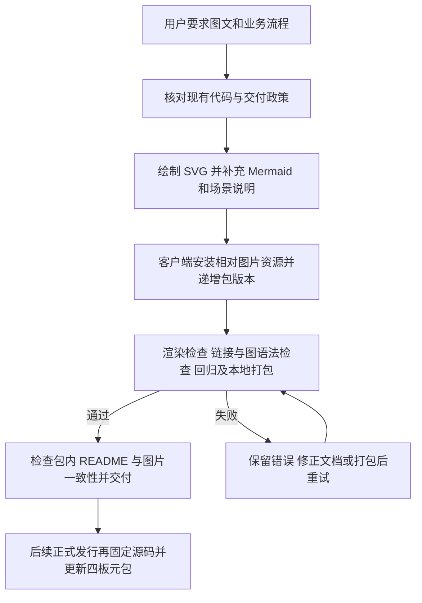

# README 图文、架构及业务流程补充

## 需求与范围

用户要求 README 同时包含图文、实现框架、业务流程和使用说明。承接
`CR-2026-10-14-readme-usage-guide`，为两仓补充可直接显示的 SVG 架构图、发行/菜单图，
Mermaid 流程及逐步操作场景。覆盖四个产品共用逻辑，CM5 PCIe1 示例明确限制在本板 profile。
本次不修改板级代码、运行时业务函数、产品 lock、历史 DEB、签名源或远端 Release。

## 业务逻辑

构建 README 增加技术框架、模块入口表、包集绑定图、构建模式决策图、完整交付图和阶段操作表。
客户端 README 增加模块框架图、菜单示意、首次使用/Overlay/换源/升级场景、渠道时序及回滚流程。
共四份原生 SVG 和七份 Mermaid 图可直接维护，配有中文标题、说明及 alt；菜单插图明确为示意，未冒充实板截图。
客户端打包入口把 SVG 安装到 README 的对应相对路径，离线查看可定位图片。
可执行 Bash 示例通过逐块语法检查，版本占位符改为交互读取明确版本，避免尖括号被 Shell 当成重定向。
客户端由上一步本地版本 1.0.3-2 递增至 1.0.3-3，保留旧本地包及旧哈希。
只读与写入命令、软件验证与实板验收、Actions DEB/APT 与本机镜像执行边界保持明确。

## 流程

## 安全与失败分支

图示只描述已存在功能和当前执行边界，不声称远端发布已完成，也不以软件测试代替实板证据。
文档链接失效、图语法失败、图片溢出、打包漏资源时停止交付并修复后重验。
包内资源必须与源码逐字节相同，不覆盖前一版本包。未使用私钥、生产凭据或板端写入操作。
保留工作区内公共下载验证器及其变更记录的其他已有修改，不为通过本任务门禁改写无关记录。
环境依赖仅用于本机文档验证，不纳入产品运行依赖；失败可修复工具后重试。

## 测试报告

| 类型 | 命令/检查 | 结果 | 证据 |
| --- | --- | --- | --- |
| static | `python3 tools/check-delivery-policy.py --peer ../ArmBianOS --peer ../PEER` | PASS | 两仓分别检查政策一致；PEER 为另一工具仓库 |
| static | README 链接/锚点、SVG XML、32 段 Bash 示例 `bash -n`、`git diff --check`、`check-repository-hygiene.py` | PASS | 构建文档 548 行/43 引用/15 Bash 段；客户端 613 行/19 引用/17 Bash 段；仅检查本地链接与锚点，远端 URL 未访问 |
| static | `node /tmp/dshanpi-docs-illustrations/check-mermaid.mjs`，Mermaid 11.4.1 `parse` | PASS | 构建 3 图、客户端 4 图全部语法通过；验证依赖仅安装在临时目录 |
| static | 新记录使用 `tools/check-change-record.py` 的 `validate_record` | PASS | 两仓本次记录结构通过；全仓状态另列下文 |
| static | `python3 tools/check-change-record.py`（全仓） | BLOCKED | 既有公共下载验证记录缺少“流程”章节，本轮未改动 |
| visual | 四份 SVG 使用系统 librsvg/cairo 渲染，查看 PNG 预览 | PASS | 本地 `/tmp/dshanpi-docs-illustrations/`，逐图确认中文文字、箭头与内容边界，无裁切 |
| software | `bash tests/test.sh`（dspi-config） | PASS | 输出 `dspi-config tests passed`；源锁、并发写入、真实 APT 扫描与模拟升级/回滚通过 |
| build | `(umask 0002; bash packaging/build-deb.sh output)`；`dpkg-deb -x` 后使用 Python 比较 README / 图片与源码 | PASS | `dspi-config_1.0.3-3_all.deb`，all 架构、Depends 不变，两张 SVG 完整、0644、字节一致；SHA-256 见下文 |
| public | 公开 APT / GitHub Release 与线上 README 展示 | NOT-RUN | 本任务未发布，未在线验收 |
| hardware | 真实菜单实板截图、启动、PCIe、升级后重启及回滚 | NOT-RUN | 本次为源码图示与软件验证，未连接实板 |

本地最终客户端 DEB SHA-256：`7b9c0e3efbb25fc9e6849e2479018fbeee44711ab8e22fa1a663c1048f595f02`。
本地构建与资源验证不表示已公开发布或已在实板安装。

## 未完成项

新客户端正式交付仍须固定提交，更新四板精确元包，完成 testing 发布及适用硬件验收。
构建仓库全仓变更记录检查已发现无关 `CR-2026-10-14-public-verifier-range-download.md`
缺少必需“流程”章节；本轮不改写它，本次记录另用同一校验器逐份核对。
仅 docs/图片变化的构建仓库沿用上轮已通过的 79 项 Python 和 Shell 回归结果；本轮执行静态检查，
不以重复完整系统构建代替文档校验。客户端打包发生变化，执行既有回归与解包验证。

## 交付影响

构建仓库只增补 README、两份图片及本记录。客户端增补 README、两份图片、VERSION 与
packaging/build-deb.sh 的文档资源安装，业务功能及 Depends 不变。新 DEB 内容变更使用新身份
1.0.3-3，本次不发布、不修改旧发行 lock。上轮 1.0.3-2 测试与包哈希记录保留其历史含义。
