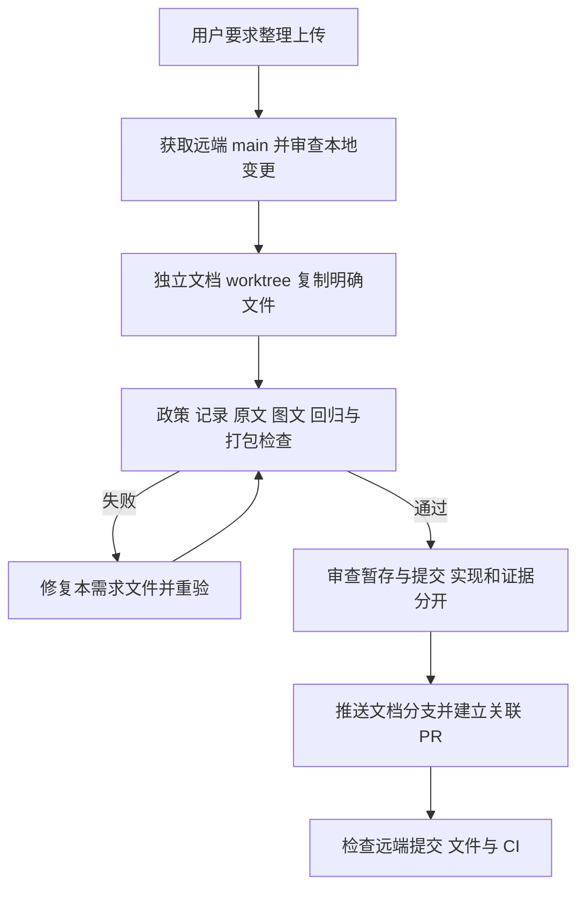

# 整理图文文档并上传源码分支

## 需求与范围

用户要求整理并上传本轮两仓文档。上传 README、SVG、开发指南、AGENTS 导航、
会话记录及客户端 1.0.3-4 的文档图片打包改动。源码上传通过短期分支与 PR，
不执行 APT/镜像发布、stable 晋级或修改产品 lock。

## 业务逻辑

从两仓远端 main 建立 docs/illustrated-user-guides 独立 worktree，逐文件复制本需求产物。
构建仓库原工作区的 AXCL 权限功能提交、公共下载器修改及其不完整记录未纳入此次文档分支。
原工作区保持原样，避免替其他任务提交或丢弃内容。实现与验证记录分开提交，推送后关联两仓 PR。
README 面向用户，门禁正文在开发指南及 AGENTS 入口中保留；指南原文与基准 README 完整比对。
构建指南的历史来源改用已公开的 main 提交；其 README 与原记录引用的分支基准字节一致。
本轮结果补充前三份历史记录：它们提到的门禁阻挡来自原混合工作区，不是本次隔离文档分支。

## 流程

## 安全与失败分支

只提交明确审查的文档及必要打包文件，不上传 output/work、凭据、私钥或其他任务实现。
不强推、不重写历史、不合并无关 AXCL 功能。远端冲突时先获取状态再处理，不覆盖他人提交。
原文、链接、包资源、暂存卫生或回归失败时修正本次内容再重试，不关闭门禁。
网络上传失败可对同一不可变提交重试；软件包与实板尚未发行的事实保持明确。

## 测试报告

| 类型 | 命令/检查 | 结果 | 证据 |
| --- | --- | --- | --- |
| static | `check-delivery-policy.py --peer`、`check-change-record.py`、`test-change-record-policy.py`、shell `bash -n` 与 `git diff --check` | PASS | 两仓从 main 隔离后全仓记录门禁均通过；记录政策测试各 3 项通过 |
| static | 本地链接、README 锚点、Bash 示例、完整原文比对，以及 Mermaid 11.4.1 `parse` | PASS | 两仓原文均完整保留，仅相对链接重定位；7 份流程图语法通过 |
| software | `python3 -m unittest discover -s tests -p 'test_*.py'`、`bash tests/test.sh`（构建仓库）；客户端 `bash tests/test.sh` | PASS | 隔离 main 基线 70 项 Python 通过（8.906 秒），两仓 Shell 回归通过；本机构建日志 `/tmp/dshanpi-docs-upload-{python,shell}.log` |
| build | `(umask 0002; bash packaging/build-deb.sh output)`；解包字节及权限比较 | PASS | 隔离 checkout 重建 1.0.3-4，与先前本地包哈希相同；README/两份 SVG 完整、图片 0644，运行脚本字节等于 main |
| public | GitHub API 核对分支 HEAD 及 README/AGENTS/指南/两图的 Git blob SHA | PASS | 首次上传提交 `7e70a4c2fa73bc152e6b2e017ccf2380c99064da` 与远端一致，5 份文档文件逐一匹配；PR 见下文；CI 最终状态以 PR checks 为准 |
| hardware | 四板实板安装、重启、外设与回滚 | NOT-RUN | 本任务不连接实板、不发布运行包 |

本轮客户端包 SHA-256：`c6e68a3a9d43c9f84ab6ed682226f5337e56a65e8ae757133e2b1aa63ced2449`。

源码上传与关联 PR：

- https://github.com/dshanpi/dshanpi-build/pull/47
- 关联仓库：https://github.com/dshanpi/dspi-config/pull/11

## 未完成项

新客户端的 APT 正式发行仍需新源码锁、四板精确元包、testing 与适用硬件验收。
源码 PR 上传不代表上述软件包或镜像已经发布。公共下载器任务和 AXCL 功能留在各自原工作区。

## 交付影响

上传两个源码文档分支及关联 PR，历史政策和门禁检查器不变，原 README 要求保留。
本需求不修改 ArmBianOS、既有 lock/包/tag 或公开运行仓库；后续包发行另行编排。
