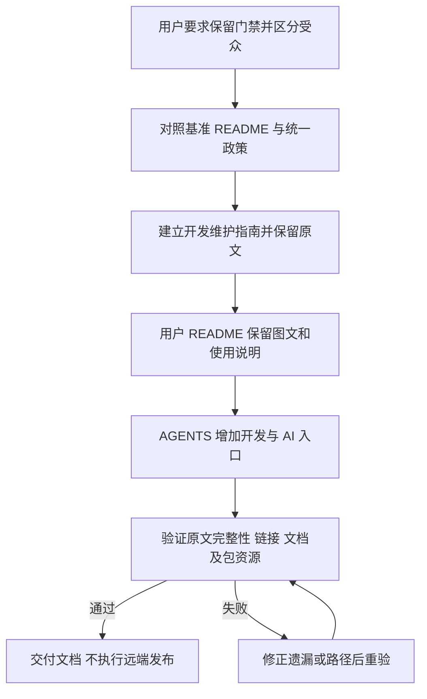

# 区分用户 README 与开发者、AI 的门禁说明

## 需求与范围

用户要求新增用户文档时保留原 README 的要求与门禁，并进一步明确：README 面向用户，
开发门禁面向开发者与 AI 工具。本轮调整文档受众和入口，保留已有图文与操作流程。
不修改运行时业务、产品配置、历史锁、交付政策或检查器，不发布包/镜像或操作设备。

## 业务逻辑

从用户 README 移出内部会话记录、提交/测试/源码卫生门禁、组件扩展及开发打包内容，
集中到 docs/development-guide.md，并在 AGENTS.md 增加开发者与 AI 的必读入口。
用户 README 保留实际操作条件、功能行为及错误处理，通过简短链接提供开发入口。
现有政策检查要求 README 保留 DELIVERY_POLICY.md 链接，因此保留链接而移出内部门禁正文；不修改检查器。
新指南列出 G01～G14 的约束，并保留改写前 README 全文，标明基准提交与历史事实边界，
仅将相对链接改为从 docs/ 访问。原有门禁不因文档重组而降级或删除，政策与检查实现不变。
客户端 README 属 DEB 有效负载，本地版本从 1.0.3-3 递增为 1.0.3-4，旧包和记录保持不变。
新开发指南供源码维护使用，不增加客户端运行依赖；用户 README 的开发指南链接指向源码仓库。

## 流程

## 安全与失败分支

不得为了简化用户文档删掉政策、绕过校验或弱化 stable、实板与不可变包要求。
原文对照发现遗漏即补齐再验；历史源码或工作流描述保留来源，不当作当前完成状态。
README/AGENTS 链接失效、代码语法或打包资源不一致时停止交付并修正，不关门禁。
保留其他任务的已有修改；无关公共下载变更记录缺少“流程”章节的问题仍单独报告。

## 测试报告

| 类型 | 命令/检查 | 结果 | 证据 |
| --- | --- | --- | --- |
| static | 两仓 `check-delivery-policy.py --peer`、`check-repository-hygiene.py`、`git diff --check` | PASS | 政策文件和检查器未修改，三仓接入一致，索引与空白检查通过 |
| static | Python 读取 `git show HEAD:README.md`，重定位相对链接后与指南原文区逐字比较 | PASS | 构建基准 `d62463bc5d457fe0f538adcd272b5478835655d8`；客户端基准 `33df6984da07d101c6e949989b2e0203db0d959c`；原文完整，非摘要替代 |
| static | README/指南/AGENTS 本地链接、README 锚点、Bash 示例语法、开发入口与本次记录结构 | PASS | 用户 README 无内部检查器命令，AGENTS 指向开发指南；图文均保留 |
| static | `node /tmp/dshanpi-docs-illustrations/check-mermaid.mjs` | PASS | 两仓共 7 份用户流程图通过 Mermaid parse |
| static | `python3 tools/check-change-record.py` 全仓检查 | BLOCKED | 既有公共下载记录缺少“流程”章节；本次记录单独通过同一校验器 |
| software | `bash -n bin/dspi-config packaging/build-deb.sh tests/*.sh` 和 `bash tests/test.sh`（客户端根目录） | PASS | 输出 `dspi-config tests passed`，源锁/并发/真实 APT 扫描及模拟升级回滚通过 |
| build | `(umask 0002; bash packaging/build-deb.sh output)`，`dpkg-deb -x` 后与源码逐字节比较 README/相对 SVG | PASS | 1.0.3-4 本地包完整，两图保留；未发布 |
| public | APT / Release 发布与公共端点验证 | NOT-RUN | 文档任务未发布 |
| hardware | 实板安装、重启与回滚 | NOT-RUN | 本轮未连接实板 |

本地客户端包 SHA-256：`c6e68a3a9d43c9f84ab6ed682226f5337e56a65e8ae757133e2b1aa63ced2449`。

## 未完成项

新版客户端正式发行须固定提交，为受影响四板生成精确元包并执行 testing/实板流程。
构建仓库既有无关变更记录缺少必需“流程”章节，仍影响全仓记录检查；本轮不改写该记录。
本次只调整文档和客户端版本，构建仓库业务代码未改变，沿用前轮已通过的软件回归证据。

## 交付影响

新增两仓开发维护指南和 AGENTS 导航，用户 README 图文保留，开发门禁迁入明确入口。
客户端有效负载更新使用 1.0.3-4，本轮仅本地验证。政策、门禁脚本、历史版本及远端状态不变。
