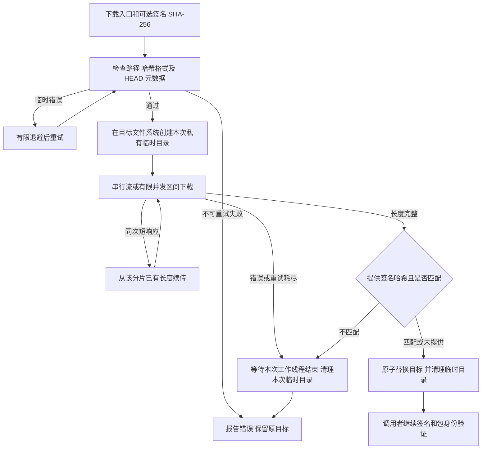

# 公共下载的失败恢复、并发隔离与校验顺序

## 需求与范围

用户要求继续检查、优化代码并上传，并明确要求作为长任务持续执行。本轮重点审查上一轮
PR #64 的下载与发布路径，修复真实可复现的问题，验证后更新同一 PR。共享代码适用于
A1、A1 CM5、R1 和 Avaota A1；不修改板级源码、客户端有效负载、包版本或已发布包集。

## 业务逻辑

对基线 `ad615ca21653b680eea26713fb058e0b830ac7df` 的回归复现表明：固定的
`.tmp.partN` 名称会重用旧下载留下的同大小分片，甚至可能在下载函数成功返回时混入旧内容；
并发下载同一目标会写入相同分片；下载后再由调用者检查 SHA-256，会将损坏包留在最终输出，
使后续整组下载被“已有包不同”检查持续阻断。

每次调用现在在目标所在文件系统创建独立的私有临时目录。仅在同次调用的有限重试中续传，
成功或异常退出时清理本次目录；原有旧式残片不会参与新下载，也不会被越权删除。两个调用者
将签名清单的 SHA-256 传给下载器，在原子替换前验证完整文件；原有签名、包身份及调用者
最终哈希检查继续保留。错误哈希不会覆盖已有目标文件，也不会把损坏包安装到输出位置。

不可重试的 HEAD HTTP 400/401/403/404 立即失败，避免重复请求和退避等待；网络错误及
暂时性服务器失败继续有限重试。公网校验器逐包向 stderr 输出进度，stdout 保持最终 JSON。
维护 skill 增加相同的不变量，后续维护不得重新引入跨调用分片或校验前替换。

## 流程

## 安全与失败分支

- 只从已验签清单取得包哈希；格式检查不能代替验签。元数据仍由原流程验签。
- 失败和成功清理限于本次临时目录；SIGKILL 等进程强制终止可能留目录，但后续调用不重用它。
- 并发调用各自保留临时目录，完整且通过要求的校验后才替换；同一目标的并发成功替换以
  最后一次为准，调用者应为不同包使用不同输出路径。
- 重试上限、连接超时、最多八个区间以及 Content-Range/长度验证保持原约束；续传只限同次请求。
- 缺包或权限错误立即停止；不把它们解释为空仓库，也不触发自动发布、回滚或 stable 晋级。
- 原始软件复现与公网验证分别记录，软件 HTTP fixture 不代表真实网络或硬件已经验收。

## 测试报告

测试日志及固定实现提交存入 `docs/validation/2026-10-16-download-recovery/`。

| 类型 | 命令/检查 | 结果 | 证据 |
| --- | --- | --- | --- |
| 修复前复现 | 在基线实现运行扩展的 downloader/cohort 测试 | FAIL | `downloader-before.log` 与 `cohort-before.log`：旧分片混入、并发冲突、分片泄漏和损坏目标留存 |
| 下载器回归 | `python3 -m unittest discover -s tests -p 'test_public_repository_download.py' -v` | PASS | 11 项，覆盖并发、旧分片、失败清理、哈希保护、有限续传和 HEAD 404 立即失败 |
| 签名整组回归 | `python3 -m unittest discover -s tests -p 'test_fetch_public_release.py' -v` | PASS | 3 项；损坏下载后不留目标，恢复服务器原包后原目录重试成功 |
| 静态检查 | Python 编译、shell `bash -n`、`actionlint -shellcheck= -pyflakes=`、`git diff --check` | PASS | 本地命令输出；workflow 无修改 |
| 政策 | `python3 tools/check-delivery-policy.py --peer ../ArmBianOS --peer ../dspi-config` | PASS | 三仓政策一致，无政策副本修改 |
| 历史 PR CI | PR #64 的 `ad615ca` 检查 | PASS | Actions run `38854104469`；不代替本轮新提交的 CI |
| 公网历史全量检查 | 上轮 Avaota `2026.10.14-1` 完整下载 | BLOCKED | 上轮记录已说明下载缓慢；本轮独立重试的实际结果见验证清单 |
| 软件全回归及本轮公网重试 | 完整单元、shell 集成与 `timeout 300` 公网 verifier | NOT-RUN | 提交前由后续证据提交记录最终实际结果 |
| DEB/镜像发布与实板 | 新包发布、升级、重启、回滚 | NOT-RUN | 本轮只修改下载/验证工具与维护资料，无包或板端操作 |

## 未完成项

本轮完整回归、公开端点重试和最终提交 CI 的结果由后续独立证据提交补齐。若公网全量下载
仍未完成，PR 保持草稿并明确未验证的包；不得用测试 fixture 或区间响应替代完整公网哈希。

## 交付影响

源码继续推送到 `fix/shared-public-download` 并更新 PR #64，复用现有审查入口。
实现与验证证据分别提交；dspi-config 和 ArmBianOS 无需新版本。四板共用修复并保持产品
隔离、精确依赖、历史包字节和 stable 状态，不执行远端服务器变更。
