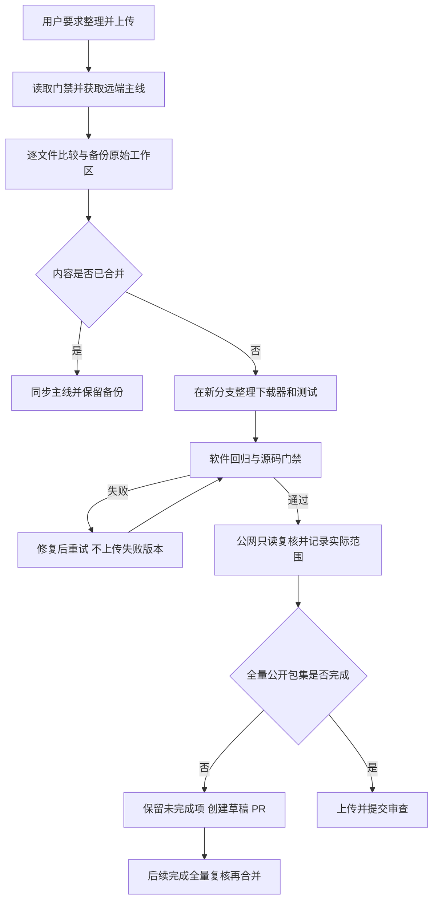

# 整理工作区并上传遗漏的公共下载器修复

## 需求与范围

用户要求整理代码并上传应上传的内容。逐文件核对工作区与最新远端主线，确认 dspi-config
的图文指南、版本和打包修改已合并到 PR #11；dshanpi-build 的指南及 SSH 发布、兼容性和
读取缓存改进也已合并。只上传尚未提交的共用公共下载器修复，避免旧工作区覆盖主线新实现。
共享下载器适用于 A1、A1 CM5、R1 和 Avaota A1；此次范围是源码整理和 PR，不包含新包、
镜像发布、stable 晋级、远端服务器配置或板端操作。

## 业务逻辑

原始修改先以具名本地 Git stash 备份，再将主线快进到远端版本。dspi-config 的全部本地修改
与主线内容一致，故同步后保持干净。dshanpi-build 从最新主线建立短期分支，仅移入未上传的
两个调用入口、共用下载器、测试和原始记录。旧 SSH 文件和 CI 依赖不重新应用。

实现提交为 `5ab00b714bbba1c271c08859b1ea255000a6898f`。两个入口共用下载逻辑，
要求 HEAD 提供正数长度；大文件按最多八个分段下载，检查 HTTP 206、精确区间及总长度；
小文件检查 HTTP 200 与完整长度。下载完成后原子替换，调用者继续验签并核对 SHA-256。
增加部分响应、错误总长度、截断和路径拒绝的回归测试，保留已有目标文件直至成功。

## 流程

## 安全与失败分支

- 原始工作区备份保留在本地；不删除历史分支、工作树、缓存、镜像或包，不强制推送。
- 若主线无法快进或有独有差异则停止覆盖，先核对内容；本次主线均可快进。
- SHA-256、签名及包身份校验继续由原调用者执行；下载失败不表示旧包被篡改，也不触发重发。
- 无效相对路径、HTTP 状态、区间、总长度和截断均拒绝；已有目标文件保持原内容，可重试。
- 软件测试不等同实板验收；公网全量下载未完成时，仅将已完成的签名、两个包及小区间检查
  记为通过。终止慢速全量只读检查，保留已取得证据，PR 保持草稿直至补齐全量公开包集验证。
- 只暂存逐项审查的源码、测试和小型证据；私钥、个人凭据及构建目录不进入提交。

## 测试报告

证据目录为 `docs/validation/2026-10-16-source-cleanup/`，JSON 固定实现提交和测试范围。

| 类型 | 命令/检查 | 结果 | 证据 |
| --- | --- | --- | --- |
| Python 软件回归 | `python3 -m unittest discover -s tests -p 'test_*.py'` | PASS | 110 项；`python-tests.log` |
| 构建发布软件集成 | `bash tests/test.sh` | PASS | `build-tests.log` 的成功结尾 |
| 客户端软件集成 | 在 dspi-config 运行 `bash tests/test.sh` | PASS | `client-tests.log`；四板 profile 为软件模拟 |
| 跨仓政策 | `python3 tools/check-delivery-policy.py --peer ../ArmBianOS --peer ../dspi-config` | PASS | 三仓检查输出；政策文件不变 |
| 静态检查 | `bash -n` 检查 shell；`python3 -m py_compile` 检查三个 Python 入口/模块；`git diff --check` | PASS | 本地命令输出 |
| 变更记录与索引 | `python3 tools/check-change-record.py`、`python3 tools/check-repository-hygiene.py` | PASS | 原始下载器记录补齐流程标题；仅审查文件入索引 |
| 公网签名及部分包 | `python3 scripts/verify-product-public.py avaota-a1 2026.10.14-1` | PASS | gpgv 验签和前两个完整包 SHA-256 已核对；`verification.json` |
| 公网大文件区间 | 请求 armbian-firmware 的 `Range: bytes=0-1023` | PASS | HTTP 206，精确 `bytes 0-1023/164280264`，1024 字节 |
| 全量公网包集 | 同一 Avaota verifier 的完整下载 | BLOCKED | 大文件下载缓慢，主动终止；全量 SHA-256 检查尚未完成 |
| 构建包与镜像发布 | 新 DEB、镜像、APT 发布 | NOT-RUN | 本次为源码整理，无有效负载变动 |
| 实板 | 四块物理板的升级、重启和回滚 | NOT-RUN | 本次没有板端操作 |

## 未完成项

合并前重新完成 Avaota `2026.10.14-1` 全量公网包集校验。本次已验证的两个包及区间响应
不能替代完整固件和其他包的哈希结果。后续 CI 状态另由 PR 检查；不将本地软件测试当作
新的硬件或完整镜像交付证据。

## 交付影响

dshanpi-build 新增一个独立修复 PR；dspi-config 的已合并内容完成本地同步，无重复提交。
ArmBianOS 主线与远端一致，无源码修改。四产品共用同一下载修复，精确包依赖、签名信任、
历史包字节、客户端版本及现有发布状态保持原样；证据与实现分开提交。
